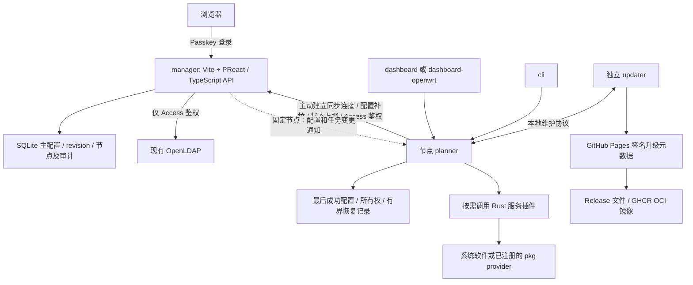

# Meduza Network Planner：全新重构开发规格

本文是交给新开发 AI 的独立规格。新 AI 不会拿到原项目源码，必须只依赖本文理解需求、设计接口并完成实现。本文描述的是要开发的新系统，不是已有代码的功能声明。

规格日期：2026-10-23。项目简称 Meduza NP；所有可分发包统一使用 `meduza-np-` 前缀。

阅读入口：[包清单](#3-包清单与边界)、[插件与界面协议](#5-插件注册与界面-json-协议)、[同步协议](#7-manager-与-planner-的同步协议)、[功能契约](#9-服务功能与生成契约)、[升级器](#13-updater-与包组升级)、[构建发布](#15-github-actions-一键构建与发布)、[验收](#17-验收与交付顺序)。

## 1. 项目目标与已经确认的决定

现有项目已难以维护，资源占用过大，需要重新开发。目标是一个按需安装、插件化、操作简洁的网络规划与节点控制系统。必须提供真实可用的配置、生成、执行、监控和升级能力，不能只做表单或展示原型。

| 事项 | 要求与本规格采用的方案 |
| --- | --- |
| 配置中心 | 取消 Etcd；manager 保存主配置，planner 主动通过 HTTPS 同步、上报，断网使用最后成功配置 |
| 节点同步 | 固定节点优先使用主动建立的 WebSocket 或 HTTP/2 流式推送通道；声明为 roaming 的漫游节点使用按需/周期拉取 |
| 重连保护 | planner 必须采用有上限的指数退避与随机抖动，统一协调所有 manager 请求，错峰恢复，防止集群重连压垮 manager |
| 实现语言 | 节点侧控制与服务逻辑使用 Rust；manager 与普通 dashboard 的前端必须 Vite + PReact；manager 后端使用 TypeScript/Node.js，普通 dashboard 后端使用 Rust；base-container 是基于 Alpine Linux 的容器运行基础，不是 Rust 包 |
| 处理器 | x86-64、ARMv7-A hard-float、ARM64/AArch64 |
| 设备约束 | 节点面向整机 RAM 128 MiB 的 OpenWrt 设备及低存储环境；manager 运行在独立服务器，不受该内存限制 |
| 例外 | Mihomo 本体可以超出低内存目标；仍需显示真实资源占用和适用条件 |
| 覆盖网络 | 取消 EasyTier，保留 Tinc；新增对应 `meduza-np-tinc` 包 |
| 路由 | 内部 iBGP；外部 BGP；新增 BFD；OSPF 仅用于内部 Anycast，不作为普通内部路由方案 |
| Access 鉴权 | OpenVPN 客户端提交用户名/密码；鉴权脚本连接本项目，经 manager 访问现有 OpenLDAP |
| manager 登录 | 使用 Passkey（WebAuthn/FIDO2）；不使用 LDAP 用户名/密码登录 |
| manager 部署 | 必须提供独立的 Podman 部署，包含生产 OCI 镜像、启动清单、持久化、HTTPS/Passkey 配置、健康检查、升级与恢复 |
| 节点容器部署 | base-container 默认安装并启动 updater，planner 为固定必备组件并由 updater 自动获取；环境变量只选择额外组件；非 OpenWrt 系统使用 Podman，默认 bridge，另支持 host 网络 |
| LDAP 边界 | 仅用于 OpenVPN Access 的用户认证与授权；只有 manager 的 Access 身份适配器访问 OpenLDAP，节点不直接连接 LDAP、不依赖 PAM |
| 软件本体 | 默认调用系统提供的软件；注册可用的 `-pkg` provider 后改用其提供的本体；mihomo-pkg 为下载/手工文件适配包，自身不携带 Mihomo |
| 管理方式 | 中心 manager、普通节点 dashboard、OpenWrt dashboard、节点 CLI；按包能力生成适配界面 |
| 按需安装 | 包清单是可选功能目录，不是必装套件；每台机器只提供其已安装、成功注册且依赖满足的包所声明的功能 |
| 更新 | updater 独立于 planner，安装后自动检查包组、安排兼容更新，与 planner 协商维护过程 |
| 代码组织 | Monorepo，每个可分发包独立目录，共享 Rust workspace 与少量公共协议/界面组件 |
| 发布 | Tag 发布；只构建变化包；未变化包复制上一版本产物；GitHub Release、Packages OCI、Pages 升级源 |

不保留 Etcd Key/API 兼容层，不要求新 AI 复刻旧 Python 容器。不能引入 Redis、消息队列或另一个分布式 KV 来替代 Etcd，除非后续用户明确提出新需求。

第三方软件本体仍保留其上游实现语言；“使用 Rust”指本项目节点控制器、插件、CLI、鉴权客户端和升级器，不意味着重写 OpenVPN、FRR、MosDNS、Mihomo 等协议实现。

## 2. 整体架构



### 2.1 控制面职责

- manager 是配置与策略的权威来源，负责多节点、用户权限、草稿、校验、发布、密钥操作、历史与状态聚合。
- planner 是节点执行面的权威控制器，负责配置应用、服务监督、插件能力、资源所有权、恢复和状态采集。
- 服务插件理解某种服务的配置、生成和探测；planner 统一调度和监督，不能每个插件再造一个完整控制器。
- dashboard、dashboard-openwrt 和 cli 是 planner 的同级客户端，不各自维护一套服务状态数据库。
- updater 是独立系统服务，不能成为 planner 的子进程或由 planner watchdog 启停。

### 2.2 进程数量原则

本项目提供 19 种可选分发包，不要求全部安装。只安装的包才参与功能注册；未安装包不加载插件、不执行探测、不启动进程、不生成配置，也不占用对应运行队列/缓存。服务插件和 `-pkg` 包默认不启动自己的常驻控制 daemon：planner 按需调用已注册插件执行校验、生成、探测，再直接监督实际软件进程。额外常驻进程必须有必要性与资源测量。

所有节点端任务都必须有超时、取消和并发上限。配置接收、心跳、Access 鉴权、升级协调不能被某个服务等待阻塞。为这些控制通道预留执行容量，不能让日志/规则下载/探测任务耗尽全部 worker。

## 3. 包清单与边界

下表 18 个指定包加保留 Tinc 所需的第 19 个包，均是独立可分发单位。它们构成可选功能目录，不能将这张表直接变成任何节点/manager 的全量安装依赖。

| 包 | 职责 | 运行和注册边界 |
| --- | --- | --- |
| `meduza-np-manager` | 中心 WebUI、API、Passkey 登录、配置/密钥/Access 身份适配器、节点状态、发布、升级策略 | 独立服务器；Vite + PReact 前端、TypeScript 后端；必须支持独立 Podman 部署，不是 planner 插件进程 |
| `meduza-np-planner` | 节点注册、同步、插件注册、服务监督、模板/生成器调度、资源事务、能力与状态上报 | Rust；节点唯一主控制器；由 procd 或其他系统 supervisor 启动 |
| `meduza-np-openvpn` | Site2Site 与 Access 多实例、证书/密钥操作、Access 鉴权 hook、连接状态 | 注册到 planner 后才有运行功能；默认系统 OpenVPN |
| `meduza-np-openvpn-pkg` | 提供经过验证的静态链接 OpenVPN 本体 | binary provider，无独立 daemon；注册后覆盖系统 OpenVPN provider |
| `meduza-np-wireguard` | 多接口、多 Peer、密钥操作、地址/MTU、握手与流量状态 | Rust 插件；使用系统 WireGuard 支持和工具；没有默认新增 wireguard-pkg |
| `meduza-np-frr` | 内外 BGP、BFD、内部 Anycast 的 OSPF、路由过滤与邻居状态 | 默认系统 FRR；按配置按需启用 zebra/bgpd/bfdd/ospfd |
| `meduza-np-mihomo` | 订阅、配置生成、Mihomo 状态、透明代理及防回环 | 默认系统 Mihomo；可选 mihomo-pkg provider |
| `meduza-np-mihomo-pkg` | 获取、验证和注册 Mihomo 本体，自身不携带本体 | 安装时可按平台从 GitHub Release 下载指定版本，或使用手工复制到持久化运行目录的文件；无独立常驻控制器 |
| `meduza-np-mihomo-openwrt` | 通过 OpenClash 管理 Mihomo 配置、控制与状态 | 仅 OpenWrt；与 mihomo 及 mihomo-pkg 都互斥；不启动第二个 Mihomo |
| `meduza-np-mosdns` | MosDNS plugins、规则文件、域名清单、配置生成、下载和状态 | 默认系统 MosDNS；可选 mosdns-pkg provider |
| `meduza-np-mosdns-pkg` | 提供 MosDNS 本体 | binary provider，无独立控制器 |
| `meduza-np-dashboard` | 普通节点本地状态界面与允许的控制操作 | Vite + PReact 构建界面，Rust 轻量 HTTP 服务提供静态资源与本地 API 适配；节点无需 Node.js/Vite；与 dashboard-openwrt 互斥 |
| `meduza-np-dashboard-openwrt` | LuCI 集成、状态、配置同步和包能力视图 | 复用 uhttpd/rpcd/LuCI；不另启 Node 或完整 Web 框架；与 dashboard 互斥 |
| `meduza-np-cli` | 节点查看、注册、诊断、同步、服务维护、升级协调 | Rust 按需进程；与两类 dashboard 同级，连接同一个 planner API |
| `meduza-np-updater` | 检查包组、兼容解析、下载验证、自动安排更新、恢复与升级结果 | Rust 独立系统服务；可与 planner 双向通信，但不受其进程监督 |
| `meduza-np-dnsmasq` | MosDNS 与 Mihomo DNS 的前置，后端启动前、下载准备及故障恢复期间提供 fallback DNS | 默认系统 dnsmasq；不启用 DHCP；独立安装/启用，可对接任一或两个后端，不强制安装 MosDNS/Mihomo |
| `meduza-np-base-container` | 基于 Alpine Linux 的容器运行基础，默认包含 updater，按环境变量自动获取并启用所选节点组件 | 发布可直接使用的基础 OCI 运行镜像与部署入口；默认 bridge，支持 host；updater 自动下载 planner/选定包，不预装全部业务功能 |
| `meduza-np-avahi` | mDNS 解析与必要的发现/转发集成 | 默认系统 Avahi，按需系统 D-Bus；不强制安装到每个节点 |
| `meduza-np-tinc` | 覆盖网络、节点公钥、hosts 与配置生成、Tinc Peer 可达状态 | 默认系统 Tinc；注册后提供覆盖网络能力 |

### 3.1 服务插件与本体 provider

`openvpn` 是控制插件，`openvpn-pkg` 只是软件本体 provider；二者不能混成一个大包。Mihomo/MosDNS 的控制与本体来源也分开；其中 `mihomo-pkg` 是特殊的获取/注册适配包，本体通过下载或手工文件提供，不进入该包的安装归档或 OCI 镜像。

选择顺序为“已注册并校验通过的本项目 `-pkg` provider → 系统 provider”。安装文件但未成功注册，不算已切换。无 provider 可用时，界面显示缺少依赖，不静默伪装成功。

注册 `-pkg` 后的切换必须经过版本/参数能力检查、预生成和实例迁移；失败保留之前正常运行的 provider，并明确显示切换失败。已经使用 pkg 的运行配置不能在二进制损坏后无提示地退回另一版本系统软件。

`-pkg` 默认不自带全部服务配置、不单独启动服务、不覆盖 `/usr/sbin/openvpn` 等系统文件。使用专属安装路径。缺失 WireGuard 内核支持时不能靠 Rust 应用包冒充可用；内核模块必须匹配目标系统。

### 3.2 互斥规则

```text
mihomo-openwrt conflicts: mihomo, mihomo-pkg
dashboard-openwrt conflicts: dashboard
```

互斥在安装计划、planner 注册、manager 配置发布和 updater 预检四处一致检查。切换需要有序停止旧 owner 并转交配置；不允许两个包同时修改同一 OpenClash/TPROXY 资源。

控制插件在系统软件满足要求时可独立提供该服务，不要求额外 `-pkg`；只安装 `-pkg` 而未安装控制插件，只增加二进制来源，不自动提供配置/启停等业务功能。不要把“需要某种软件”硬编码成“必须安装本项目本体包”，否则违反默认使用系统软件的要求。

### 3.3 mihomo-pkg 的下载与手工文件模式

`meduza-np-mihomo-pkg` 仅包含轻量 Rust 获取/检查工具、provider 描述、版本/平台获取清单和界面 JSON。它自身不包含 Mihomo 可执行文件，也不在构建本项目包时预先将 Mihomo 打进归档或镜像。`meduza-np-mihomo` 继续负责配置、进程、监控与 TPROXY，该包只准备可注册的二进制来源；与 mihomo-openwrt 的互斥关系不变。

必须提供两种明确模式：

| 模式 | 安装/准备行为 | 本体更新责任 |
| --- | --- | --- |
| `auto-download` | 可在安装阶段按平台从指定 GitHub Release 获取指定 Mihomo 版本，完成验证后放入持久化运行目录 | 按包组中已批准的本体版本与维护策略更新，不跟随未锁定的 latest |
| `manual` | 禁止联网获取；用户自行复制已解压的 `mihomo` 可执行文件到公开约定的持久化运行目录，再触发检查/注册 | 用户管理文件；普通安装、包升级和自动 updater 不覆盖或删除该文件 |

#### 3.3.1 平台匹配与自动下载

识别操作系统、CPU 架构、位宽/端序、必要指令集和运行兼容条件，使用已测试的映射表选择上游 asset；覆盖本项目 Linux x86-64、ARMv7-A hard-float、ARM64 节点。不能把 OpenWrt 包架构标签直接拼成上游文件名，也不能默认选择要求更高指令集的 x86 优化版本。

默认来源为 [Mihomo 上游 GitHub Releases](https://github.com/MetaCubeX/mihomo/releases)，使用明确 release tag、asset 标识/名称、下载 URL 和预期摘要；平台映射随包元数据版本化，不把某次发布的文件命名规律当成永久协议。API 获取参照 [GitHub Release assets](https://docs.github.com/en/rest/releases/assets)。

下载必须有大小/超时限制、流式写入、可取消任务、指数退避和随机抖动，遵守 GitHub 的限流/Retry-After。允许配置已可用的下载代理；不能要求先启动待下载的 Mihomo 才能下载它自身。

先写同一持久目录下的 staging，校验可信预置摘要、压缩内容和解压路径、ELF 架构/兼容性、执行权限，再以受限探测确认版本/所需能力；成功后原子替换并注册。禁止下载后直接执行未检查的文件，或原地写坏正在运行的本体。下载失败保留上一可用本体；首次失败显示 waiting-binary/download-failed，不能令 planner 或其他服务无法启动，也不能在安装 hook 中无限等待网络。

#### 3.3.2 持久化目录与手工复制

必须公布可配置的 `binarySource.dataDir`；默认位于平台确认可持久化的 `<persistent-state-dir>/providers/mihomo/`，不能放到 `/run`、`/tmp` 或未挂载卷的容器可写层。例如普通 Linux 为 `/var/lib/meduza-np/providers/mihomo/`，OpenWrt 可使用 `/etc/meduza-np-state/providers/mihomo/`；实际安装路径必须在界面和 CLI 显示，并在设备重启后保留。

```text
<binarySource.dataDir>/
  mihomo                 用户手工放置或自动下载后激活的可执行文件
  provider.json          来源、模式、版本、平台、摘要与注册结果
  .staging/              临时下载/导入候选，空间有界
  previous/              自动更新需要时保留的一份上一可用本体
```

用户可以在完全离线、GitHub 不可达或其他严格网络环境中，将正确平台的已解压文件复制为 `<binarySource.dataDir>/mihomo` 并设置执行权限。手工替换应先停用受影响实例，或采用临时文件加原子替换，不直接改写运行中的文件。提供界面/CLI 的“检查本地文件”“注册/激活”操作，不要求为这一流程访问 GitHub、manager 的下载接口或重新打包安装包。

manual 模式下，安装、重启、provider 检查和包升级均不发起本体下载；已有手工文件必须优先保留。自动模式检测到已有手工文件时也不能悄悄覆盖，需保持其来源/管理模式；文件已存在但没有可信的自动下载所有权记录时，按 user-provided 保护，先提供本地检查/注册路径。缺文件、架构错误、不可执行或功能不兼容时保留包为已安装状态，并明确报告 provider 未就绪；不能把不兼容文件标为注册成功。

手工文件同样检查类型、路径/权限、平台、版本与必要能力，并记录 SHA-256。离线时不强制在线获取摘要；有可信预置摘要则校验，没有时明确记录为 user-provided，不把“已计算摘要”误报为“已验证官方来源”。包升级/普通卸载不得清理手工本体及运行数据；有界清理仅处理已证明归本项目所有的 staging/自动更新备份。

#### 3.3.3 注册、界面与容器

软件来源显示为 `system`、`github-release` 或 `user-provided`，并分别记录适配包版本、实际 Mihomo 版本、文件路径、平台、摘要、验证状态、下载阶段和最近错误。提供模式/目标版本/下载代理/持久目录设置、下载重试、本地检查与受控激活动作；不要只显示 `mihomo-pkg 已安装` 就认为本体可用。

本体准备成功后才注册 `mihomo.binary` provider，仍按第 3.1 节的迁移预检和健康验证切换；失败保持现有可用 provider。planner 只在成功切换后重启受影响的 Mihomo 实例，不重启无关 VPN/DNS。

Podman 节点部署必须为该目录挂载持久卷，支持重建容器后继续使用下载/手工放置的本体。`mihomo-pkg` 自身 OCI 分发镜像仍不包含 Mihomo，不能把安装时下载悄悄变成 Containerfile 构建时内嵌。

### 3.4 按已安装包提供功能

功能可用性由“已安装包 → 已注册能力 → 必需系统依赖/provider → 配置启用”逐层决定。安装不等于启用，未安装更不能因为配置中出现字段就自动具有该功能。

| 安装组合 | 提供的功能与边界 |
| --- | --- |
| 服务器仅 manager | 提供中心管理、Passkey、配置与 Access 身份后端；不要求安装 planner、任何节点插件或节点 dashboard |
| 节点仅 planner | 提供节点注册/同步、包能力、基础资源管理与监督框架；没有 VPN、FRR、代理、DNS 或 Web 界面，不因缺可选包报警 |
| planner + wireguard | 系统 WireGuard 依赖满足后提供 WireGuard 配置/控制/状态；不要求 Tinc、OpenVPN、FRR、DNS、dashboard 或 updater |
| planner + openvpn | 系统 OpenVPN 可用时提供 Site2Site/Access；Access 在线鉴权按需依赖 manager，但不强制安装 openvpn-pkg 或 FRR |
| 任一最小节点 + dashboard 或 dashboard-openwrt 或 cli | 仅增加所选管理入口；入口展示和操作该节点真实存在的功能；两类 dashboard 继续互斥，cli 可独立共存 |
| 任一最小节点 + updater | 增加自动升级；未安装 updater 的节点照常运行和同步，不提供自动升级 |

上述 updater 可选适用于原生部署；base-container 默认自带并启动 updater，planner 始终必备并由 updater 自动获取，环境变量只选择额外的可选组件。环境变量声明不等于功能已可用，仍须下载、校验、安装、注册并满足依赖后才提供对应功能；具体引导规则见第 14.3 节。

硬依赖只描述该包真正必需的框架/系统组件，业务联动使用可选能力引用。例如不使用 BGP 的 VPN 不依赖 frr；只在启用 VPN→BGP 绑定时要求 frr，只有配置 mDNS 桥接时才需要相应 DNS/Avahi 能力。不得为实现一项功能默认拉入全部网络服务或所有 `-pkg`。

包未安装属于正常部署状态，不是节点故障。已安装但注册失败、系统依赖缺失、本体未准备好则显示该包的具体原因；不能阻塞其他已可用功能。若发布配置明确启用了缺失能力，manager 在发布前拒绝并指出目标节点和所需包；planner 也需做同样校验并保留最后成功配置，不能静默忽略后报告已应用。

卸载/撤销注册后停止对应配置生成、探测和任务，并按所有权有序清理该功能的运行资源；若其他已启用功能依赖它，先给出依赖冲突或在明确停用计划中处理，不顺带卸载无关包。历史配置/状态可保留供审计，但不能继续当作实时功能或支持的动作。

## 4. Monorepo 组织

```text
meduza-network-planner/
  AGENT.md
  Cargo.toml                         Rust workspace
  Cargo.lock
  rust-toolchain.toml
  package.json                       manager/dashboard 前端及 manager 后端 workspace
  <唯一前端 lockfile>
  packages/
    meduza-np-manager/                web/ server/ package.json manifests/ Containerfile deploy/podman/
    meduza-np-planner/                Cargo.toml src/ manifests/ packaging/
    meduza-np-openvpn/
    meduza-np-openvpn-pkg/            上游源码锁定、构建配方、许可、provider 描述
    meduza-np-wireguard/
    meduza-np-frr/
    meduza-np-mihomo/
    meduza-np-mihomo-pkg/             下载/手工文件适配、获取清单，不含 Mihomo 本体
    meduza-np-mihomo-openwrt/
    meduza-np-mosdns/
    meduza-np-mosdns-pkg/
    meduza-np-dashboard/              web/ package.json vite.config.ts Cargo.toml src/ packaging/
    meduza-np-dashboard-openwrt/
    meduza-np-cli/
    meduza-np-updater/
    meduza-np-dnsmasq/
    meduza-np-base-container/         基础运行镜像、运行入口、bridge/host Podman 部署清单
    meduza-np-avahi/
    meduza-np-tinc/
  crates/
    protocol/                        版本化 DTO、错误、revision、状态
    plugin-sdk/                      插件输入输出与生成计划
    runtime/                         文件、进程、接口、所有权等公共原语
  web/
    ui-kit/                          PReact 表单、状态表、密钥控件等
    descriptor-renderer/             JSON 描述渲染器
  schemas/                           公共 JSON Schema / OpenAPI
  tools/                             变更计算、打包、签名、发布
  release/                           发布格式、目标矩阵、公钥及配置
  tests/                             跨包测试、设备验收、故障注入
  .github/workflows/
    ci.yml
    release.yml
```

公共 crate/前端库是内部构建单元，不必再作为额外安装包发布。不得通过公共 runtime 把全部服务模板、WebUI 或下载器链接到 planner。

每个包自行提供 manifest、界面 JSON、配置 Schema、状态定义、必要模板/生成器、打包配方、测试和许可证。节点上只安装预构建产物，不安装 Cargo、Node、npm 或编译工具链。

## 5. 插件注册与界面 JSON 协议

### 5.1 注册对象

planner 扫描固定目录内已安装且版本兼容的包描述，维护注册表。至少区分：服务适配器、软件本体 provider、界面客户端、CLI、独立 updater、容器运行基础。base-container 提供运行环境，不注册为 planner 监督的业务进程。不能因为都有 manifest 就把 manager/CLI/updater 当成普通子服务启动。

注册表每项必须具有：包名、包版本、包摘要、协议版本、角色、依赖/冲突、提供能力、系统依赖、界面描述摘要、注册状态、错误原因。

一个 manifest 的示例：

```json
{
  "manifestVersion": 1,
  "package": "meduza-np-openvpn",
  "version": "0.1.0",
  "role": "service-adapter",
  "plannerApi": {"min": 1, "max": 1},
  "requires": ["meduza-np-planner"],
  "conflicts": [],
  "provides": ["openvpn.site2site", "openvpn.access", "openvpn.keygen"],
  "providerSlot": "openvpn.binary",
  "schemas": {"config": "schema/config.json", "status": "schema/status.json"},
  "ui": {"descriptor": "ui/descriptor.json", "version": 1},
  "entrypoint": "/usr/libexec/meduza-np/plugins/openvpn",
  "operations": ["validate", "plan", "probe", "generate-keys"]
}
```

不得使用不稳定的 Rust 动态库 ABI 作为插件协议。首版使用有版本的本地 JSON 协议：planner 以参数数组启动包内受信可执行程序，一次处理一个有大小限制的请求；stdin 是 JSON，stdout 只有一个 JSON 结果，stderr 为脱敏日志。服务状态探测按调度触发，不要求插件进程常驻。

### 5.2 生成计划

服务插件 `plan` 不直接修改系统，返回结构化的计划：文件、进程定义、网络资源、依赖、探测方法和期望输出。由 planner 校验所有权、冲突、路径与权限后统一应用。

```json
{
  "protocolVersion": 1,
  "requestId": "req-example",
  "instance": "openvpn/office",
  "files": [
    {"path": "openvpn/office/config.ovpn", "mode": "0600", "content": "dev tun-office\n", "sensitive": true}
  ],
  "processes": [
    {
      "id": "openvpn/office",
      "providerSlot": "openvpn.binary",
      "argv": ["--config", "${GENERATION_ROOT}/openvpn/office/config.ovpn"],
      "restart": "on-failure",
      "stopTimeoutSeconds": 10
    }
  ],
  "resources": [],
  "dependsOn": []
}
```

文件路径是代际目录内的相对路径；只有受控占位符可展开。不接受任意 shell 命令字符串。密钥不放入 argv、探测结果、错误、审计或普通日志。生成器必须确定性输出；网络下载、密钥生成等动作与纯渲染分开。

### 5.3 界面描述

每个包必须提供可验证的 JSON 界面描述，不能只有 `enabled` 开关。配置 Schema 负责类型、默认值和约束，界面 JSON 负责布局、列表、向导、状态列、动作和适用条件。

```json
{
  "uiVersion": 1,
  "package": "meduza-np-wireguard",
  "requiresCapability": "wireguard.interfaces",
  "title": "WireGuard",
  "collections": [
    {
      "path": "services.wireguard.instances",
      "itemId": "id",
      "columns": ["name", "device", "enabled", "runtime.state", "runtime.latestHandshake"],
      "sections": [
        {"title": "接口", "fields": ["name", "enabled", "device", "addresses", "listenPort", "mtu"]},
        {"title": "密钥", "fields": ["privateKeyRef"], "widget": "keypair"},
        {"title": "Peers", "path": "peers", "widget": "editable-table"}
      ],
      "actions": [
        {"id": "generate-keypair", "label": "生成密钥对", "mutating": true},
        {"id": "restart-instance", "label": "重启", "mutating": true}
      ]
    }
  ]
}
```

渲染器只能调用已注册的动作和内置控件，不能执行 JSON 中的任意 JS、HTML 或 shell。动作 ID 必须能映射到有权限检查的后端接口。

manager 与普通 dashboard 均使用 Vite + PReact + TypeScript 构建界面，共用 PReact 控件、JSON 描述渲染器与状态语义。普通 dashboard 独立构建，不把完整 manager 后端或管理端全部页面带到节点。OpenWrt dashboard 继续使用轻量 LuCI 适配器呈现同样的字段、动作和状态含义，不要求把 PReact runtime 强塞到 LuCI。

manager 从已验证的包元数据解析相应版本 UI；节点上报已安装版本及描述摘要。功能导航、表单、动作和实时状态按当前选中节点的包/能力集合生成，未安装功能不显示为可操作业务入口；可在独立包目录/安装建议中显示为“未安装”。已安装但未启用、注册失败、缺依赖、provider 失效必须分别显示。未知协议应明确标为不兼容，不显示一个永远提交不了的通用表单。多节点选择需标明共同能力和不兼容节点，不能拿其他节点已安装的包作为本节点支持依据。

## 6. manager：主配置、操作面板与身份

### 6.1 技术与存储

前端采用 Vite + PReact + TypeScript；生产提供构建后的静态资源，Vite 开发服务器不作为生产后端。后端 TypeScript/Node.js 提供 API、Passkey/WebAuthn 验证、SQLite 持久化、Access 的 OpenLDAP 适配和任务调度。

SQLite 保存节点、拓扑、配置 revision、发布记录、秘密引用、manager 账号/角色、Passkey 公钥凭据、Access 授权映射、升级策略和有界状态历史。无需额外数据库服务。大型规则/导出文件与秘密材料独立管理，不把全部二进制或无界状态逐条塞入数据库。

### 6.2 面板必须完整支持的操作

| 页面/区域 | 必须具备的交互 |
| --- | --- |
| 总览 | 节点在线、固定/漫游声明、同步模式/通道及降级原因、最后接收/应用 revision、同步错误、启用功能、资源摘要、升级计划 |
| 节点 | 注册/撤销、名称和标签、组网成员、系统架构、安装包和实际 provider、依赖问题 |
| 配置发布 | 草稿、即时字段校验、跨字段检查、目标节点、脱敏差异、预生成、发布、逐节点结果、回滚 |
| 功能配置 | 按已注册包呈现全部支持字段、实例、Peer、规则、证书、绑定关系和高级配置 |
| 连接与路由 | OpenVPN 客户端/隧道、WireGuard Peer 握手、Tinc Peer、BGP/BFD/Anycast OSPF 邻居状态 |
| 密钥与 PKI | 生成/导入/派生/安全导出、证书有效期、CSR/签发、撤销/CRL、WireGuard PSK、Tinc 公钥 |
| DNS 与代理 | 后端就绪、fallback 状态、规则下载进度/失败、订阅刷新、TPROXY 安装/排除范围 |
| 升级 | 包组、单包版本、架构、复用来源、预检、维护窗口、当前步骤、失败/回滚结果；节点详情支持检查更新、立即升级及请求投递/接受/失败状态；operator/admin 可执行，viewer 只读 |
| 身份与权限 | manager Passkey 登记/命名/撤销、账号与角色；Access 的 OpenLDAP 连接、搜索/组映射测试与授权策略 |
| 诊断 | 有界日志、依赖/端口/内核检查、配置生成错误、脱敏支持导出 |

常用操作不能要求编辑原始 JSON。多实例与 Peer 使用表格/侧栏，支持复制、批量启停、搜索；危险操作显示具体影响。raw 配置编辑器只作为高级入口，仍走同一 Schema、权限和发布流程。

所有页面使用加载/空数据/过期/失败状态，不把“没有收到上报”显示为“服务正常”。服务安装、配置启用、运行正常、协议建立和配置同步是不同状态。

拓扑画布应占用当前窗口的剩余空间，不能以固定最小高度或画布固有尺寸撑出页面滚动条。缩放窗口时同步调整位图与投影：全图/聚焦模式重新适配原目标，手动视角按比例保留缩放和平移关系。IP/节点标签按稳定 ID 保留避让位置，悬停、选中和报告数组顺序变化不能让标签反复消失、换位或重新扰动已稳定的布局；只有实际拓扑变化才重新驱动物理布局。

IP/节点标签与 AS 标签共同参与 3D 深度排序，不能作为最后一层不透明覆盖物遮住场景；同深度优先显示节点和连线。标签背景使用低不透明度，避让计算同时考虑节点、连线和其他标签，拥挤时增加候选位置并以引线标明所属对象。跨越较大深度的连线分段参与排序，标签随所属对象的投影移动，不固定在窗口边缘。

AS 集群、折叠 AS 与 AS path 节点的标签将 AS 号和登记名称分为上下两行；无名称时只显示 AS 号。以两行文字的完整范围为 Router ID/IP/域名标签保留避让空间，AS 名称或投影变化使缓存位置重叠时必须重新选择位置；悬停仅改变强调效果。

拓扑物理布局必须在 X/Y/Z 三个维度上计算 AS 分组及组内节点的位置、排斥、弹簧和碰撞，不能只旋转相机观看平面布局。新节点采用确定性的球面分布，AS 分组按大小分配三维锚点并作为球体保持间距；跨 AS 连线仅弱平移分组，避免拆散分组。仿真收敛后应保留空间体积，状态刷新不能重新扰动，手动旋转、拖动和分组间距控制仍然可用。

FRR 学习到的对端 Router ID 用于拓扑去重，身份按 ASN 与有效非零 IPv4 Router ID 共同确定。同一身份优先匹配已发布配置中的唯一受管节点，FRR 专属 routerId 覆盖通用 node.routerId；不得将不同 AS 或重复配置同一 Router ID 的多个受管注册记录强行合并。未受管对端的多地址、多观察节点会话归为一个路由器，保留各自地址、状态、路由及 AS path。相同 ASN/地址已有无冲突学习结果时可归并尚未学习 Router ID 的会话；冲突地址和未知 Router ID 不猜测归属。重连时仍上报的已学习 ID 保留身份，空值、0.0.0.0 和非法 ID 不用于合并。页面刷新自动更新，合并消失的旧选中项不得留下空详情卡片。

Manager 全局设置提供“AS 地址设置”选项卡，维护名称与 ASN 映射，经保存和应用后生效。ASN 必须为 1..4294967294 的整数，同一 ASN 只能对应一个名称。WireGuard/OpenVPN 对端 ASN 支持手动输入或选择列表，配置仍存数值 ASN。拓扑在 AS 集群、折叠节点及 AS path 标签中按已发布映射追加名称，手动输入的同号 ASN 同样可显示名称。名称仅为 Manager 展示元数据，不分发到节点；改名或删除映射不得触发网络重新应用或修改已有对端 ASN。

AS 地址列表允许通过行手柄拖动排序，并提供上移/下移按钮用于键盘和触屏操作。顺序作为同一配置数组的一部分，经保存、应用后持久化并用于对端 ASN 选择列表；排序不得修改名称、ASN 或节点网络配置。只读账号不提供排序操作。

Manager 和普通 Dashboard 共用浏览器中的主题偏好，显式选择浅色或深色后完整刷新仍应保持；跟随系统时由系统配色决定。主题必须在首屏绘制前恢复，不能等待应用模块执行而先显示浅色；使用符合现有 CSP 的同源外部初始化脚本，存储不可用时仍可正常启动。

### 6.3 密钥操作

- WireGuard：真实 X25519 私钥/公钥生成、公钥派生、PSK 生成、格式检查；生成按钮不能只造随机文本占位。
- OpenVPN：CA、服务器/客户端密钥与证书、CSR、有效期、扩展用途、静态密钥及 TLS 控制通道材料；使用成熟 PKI 实现或选定 provider 的命令，不能手工拼 ASN.1 或自研密码协议。
- Tinc：按目标系统/provider 支持的密钥格式生成，在节点或 manager 侧执行受控任务，公开组网数据中只分发公钥。
- 默认优先让节点私钥留在生成节点；manager 生成/导入模式也必须可用，只向需要它的节点交付。明确区分“重新显示已有秘密”和“重新生成并使现有连接失效”。
- 不在浏览器 localStorage、日志、状态包或普通审计差异中保存明文秘密；导出是单独的授权操作。

### 6.4 manager 的 Passkey 登录

manager 的人工用户登录采用 Passkey（WebAuthn/FIDO2），不提供密码或 LDAP 登录回退。manager 账号与 admin/operator/viewer 角色在本项目内管理，不从 LDAP 用户 DN 或组自动获得管理权限；OpenLDAP 只服务于第 6.5 节的 Access 鉴权。

必须实现以下能力：

- 使用成熟的 WebAuthn 服务端/浏览器库实现真实注册与登录；支持平台及硬件认证器、同一账号登记多把 Passkey、命名、最近使用时间和撤销。
- 首次管理员登记通过服务器侧控制的一次性、有时效的 bootstrap 流程，完成后关闭公共初始化入口；后续账号/凭据登记必须经过已授权管理会话或受控邀请，禁止匿名抢注管理员。
- 注册要求可发现凭据，注册和登录要求 `userVerification=required`；生产使用 HTTPS，明确配置 RP ID、RP 名称和允许的 Origin。
- challenge 必须随机、有时效、单次消费，并绑定相应会话/登记意图；服务端验证 challenge、Origin、RP ID、签名、用户验证标志与账号/凭据归属，拒绝过期或重放。
- SQLite 只保存 credential ID、公钥、账号关联、必要计数器/备份状态等验证数据，私钥留在认证器；兼容同步 Passkey 的计数器行为，不能一概要求每次计数器严格递增。
- 凭据增删、角色变更和会话撤销具有审计；防止移除最后一个可登录管理员的全部凭据。丢失凭据的恢复采用有审计的服务器管理员离线重置/重新登记流程，不引入隐藏的密码登录入口。

建议提供 `/api/v1/auth/passkeys/register/{options,verify}`、`/api/v1/auth/passkeys/authenticate/{options,verify}`，以及已授权的凭据列表/撤销和注销接口。具体路径由 OpenAPI 固定；注册接口的 bootstrap/会话权限必须在服务端验证。

登录成功后建立受保护会话 Cookie，处理会话到期、注销、CSRF/来源和逐操作权限校验；密钥导出等敏感操作支持近期 Passkey 再验证。manager 会话、节点机器身份、Access 用户认证三者独立，LDAP 故障不能使正常 Passkey 登录失效。实现依据为 [WebAuthn 规范](https://www.w3.org/TR/webauthn-2/)。

### 6.5 OpenLDAP：仅用于 OpenVPN Access

manager 的 Access 身份适配器是现有 OpenLDAP 的客户端，不是 LDAP 目录替代品。首版支持 LDAP/LDAPS、StartTLS、搜索 base DN、服务 bind DN/凭据、用户和组过滤器、CA 与连接超时。生产默认校验证书。

用户查询参数必须做 LDAP filter escaping，要求唯一匹配用户，并以该用户 DN 重新 bind 校验密码；再检查配置的授权组/规则。拒绝空用户名/密码，不能把匿名/未认证 bind 的成功当作用户认证成功，也不能只检验搜索服务账号可用就允许登录。认证使用 LDAPS 或强制成功的 StartTLS，不能降级到明文发送用户密码。[OpenLDAP 身份与传输安全](https://openldap.org/doc/admin26/security.html)。

LDAP 组仅映射到 Access 授权策略，至少支持指定组以及节点/实例范围，不映射 manager 管理角色。不默认写入或创建 LDAP 用户；面板配置连接和 Access 授权映射，用户目录仍由现有系统维护。

LDAP 服务凭据仅保存在 manager 的秘密存储中，不下发节点。Access 的用户名/密码只能进入专门鉴权接口，不能用于创建 manager 登录会话或登记 Passkey。配置发布与升级等动作有脱敏审计。

manager 的秘密正文需加密保存，密钥与数据库备份分离；节点长期身份和最后成功配置所需秘密独立以最小文件权限保存。备份/恢复必须说明秘密引用和加密密钥如何恢复，不允许导出一个无法重放的配置引用集合后称为完整备份。

### 6.6 manager 的生产部署

manager 必须支持在独立服务器通过 Podman 部署，不要求先安装 planner 或节点 base-container。发布镜像包含编译后的 PReact 静态资源、生产 TypeScript 后端及必要运行依赖；部署不需要在宿主安装 Node.js/npm、克隆仓库或现场编译。具体镜像、卷、配置与运维契约见第 14.4 节。

## 7. manager 与 planner 的同步协议

### 7.1 连接与身份

planner 主动连接 manager，节点不要求可被公网反向访问。首次使用有时效、一次性的注册凭据换取独立节点机器身份；后续使用 HTTPS 和可撤销/轮换的节点凭据。优先采用客户端证书，协议允许已明确实现的等价设备认证方式。

节点只能读取自身编译后的配置、上报自身状态、为授权的本节点 Access 实例申请鉴权。不得读取整个集群的私钥或其他节点的秘密。

推送同样复用 planner 主动建立的出站连接，不要求 manager 向节点建立入站连接。节点行为由明确的 `node.behavior=static/roaming` 声明决定，默认 static；不能仅凭一次 IP 变化猜测为漫游节点。首次注册/初次连接先短请求拉取本节点配置，确认声明和双方能力后选择同步通道。

### 7.2 必须明确的 revision

| 字段 | 含义 |
| --- | --- |
| `desiredRevision` | manager 希望节点运行的配置 |
| `receivedRevision` | 已完整收到并验证封装的配置 |
| `validatedRevision` | 已通过本节点能力与完整计划校验 |
| `appliedRevision` | 本地所有必需步骤成功并持久化的配置 |
| `observedRevision` | 本次状态观测关联的运行配置 |
| `lastSuccessfulRevision` | 最后成功稳定版本，用于恢复/回滚 |

revision 是 manager 生成的不可变标识，附 schemaVersion、配置摘要和生成时间。发布后不能修改同 revision 的内容。回滚也创建新的发布记录和 revision，不能倒写历史。

当前应用状态不得被历史失败指针覆盖：收到应用成功 ACK 时清理同版本及更早版本的活动失败标记，保留 ACK 历史；已接受的新报告确认配置 `in-sync` 且 desired/applied 相等、无恢复错误时，也应修正成功 ACK 丢失或去重留下的旧状态。报告中的 `lastError` 可能是拉取任务等控制请求的 429/网络错误，不能据此把已成功应用的配置显示为应用失败。版本号相同但当前明确报告应用失败或恢复降级时仍显示对应异常。

### 7.3 建议 API 契约

具体框架可以选择，但以下语义必须实现，并在 OpenAPI/协议 Schema 中固定：

| 接口 | 用途 |
| --- | --- |
| `POST /api/v1/nodes/enroll` | 节点注册 |
| `GET /api/v1/nodes/self/config?after=<revision>` | 初次同步、漫游轮询、断线补拉和定期校准；支持 ETag/未变化响应，也可按明确 revision 读取不可变快照 |
| `GET /api/v1/nodes/self/stream` | 固定节点的 WebSocket 升级入口，使用节点机器身份认证 |
| `GET /api/v1/nodes/self/events?cursor=<eventId>` | 可选 HTTP/2 长响应事件流入口，与 WebSocket 使用相同业务事件协议 |
| `POST /api/v1/nodes/self/reports` | 心跳、能力、同步和运行状态 |
| `POST /api/v1/nodes/self/acks` | 应用阶段与结果确认，幂等 |
| `POST /api/v1/nodes/self/access-auth` | manager 接收节点转发的 Access 用户鉴权 |
| `GET /api/v1/nodes/self/jobs` | 拉取已授权的密钥/维护等有界任务 |
| `POST /api/v1/nodes/self/jobs/<id>/result` | 幂等任务结果 |
| `POST /api/v1/drafts`、`/validate`、`/publish` | manager 草稿、预检、发布 |

同步策略按节点声明选择：

| 节点行为 | 默认策略 | 降级与恢复 |
| --- | --- | --- |
| `static` 固定节点 | 优先单条出站推送连接；首版建议实现 WSS，HTTP/2 流式通道可作为等价实现/后续选项，不要求同时常驻两种通道 | 通道或中间代理不支持时降级为 HTTPS 拉取，报告原因；按退避重试恢复推送 |
| `roaming` 漫游节点 | 短请求的周期/按需 HTTPS 拉取，不维持配置推送订阅；网络恢复后经错峰调度同步 | 无网络时使用最后成功配置，恢复后按统一退避补拉；不能自动升级为常驻推送模式 |

这里的 HTTP/2 推送指 planner 先发起订阅请求、manager 在该长响应中发送有界分帧事件，并非把 `PUSH_PROMISE` 资源预推送机制当成任意双向消息总线。HTTP/2 的上行报告/ACK 仍可走同连接上的独立请求。WebSocket 使用 WSS 和协议 Ping/Pong；两者共用事件封装和权限语义，不引入额外 gRPC/消息队列作为必备依赖。[HTTP/2 RFC 9113](https://www.rfc-editor.org/info/rfc9113/)、[WebSocket RFC 6455](https://www.rfc-editor.org/info/rfc6455/)。

初始建议固定节点状态心跳 15 秒、推送保活 30 秒；漫游节点轮询 60 秒，并尽量与状态上报合并，不强制另发固定节点频率的心跳。间隔均可配置并加入抖动，请求/保活超时和重试有上限。漫游节点不为维持 NAT 映射而持续 Ping；节点离线判定与其实际轮询/上报策略匹配，不能因未使用固定节点推送保活就误报离线。大日志、规则/升级包下载不能占满控制通道。

推送默认传递小型的配置/任务可用通知，由 planner 按 revision 补拉完整一致快照；后续若直接推送完整配置封装，也必须走相同验证与应用流程。例如：

```json
{
  "eventVersion": 1,
  "eventId": "event-123",
  "type": "config.available",
  "nodeId": "gw-a",
  "revision": "rev-000043",
  "configDigest": "<sha256>"
}
```

每条事件带版本、节点范围和可恢复游标；游标只是通知续传位置，不等于配置已成功应用。重连提交最后事件游标与最后成功 revision，manager 补发可用事件；游标失效或发现缺口时通过 HTTPS 获取当前完整配置。重复通知按 ID/revision 去重，过时通知不覆盖最新期望状态。

不能只依赖“收到推送”判定同步完成：received/validated/applied 和相应 ACK 仍独立。订阅建立后执行一次当前 desiredRevision 校准，避免初次 GET 与订阅之间丢变更；连接正常时也低频核对当前 revision，弥补丢事件。通知队列有界，配置通知可合并为最新目标，必须执行的任务则有独立持久记录/幂等任务 ID，不能被合并丢弃。

配置可以是完整小快照，也可以后续增加补丁；首版必须保证完整快照的一致性，不能拼接来自不同 revision 的数据。manager 根据拓扑生成本节点所需的对端公钥、地址、邻居与授权信息，不发送整个集群原始数据库。

### 7.4 断网与重启

断开 manager 不停止已经成功配置的 VPN、路由或 DNS。planner 重启从最后成功配置恢复，然后重新同步。只有本地应用成功才更新成功状态；状态上报失败不回滚已经成功的配置。

推送断线必须采用第 7.5 节的指数退避与随机化规则；取得调度许可并恢复连接后先补拉/核对 revision，再继续订阅，不能凭内存中最后一条事件推断已经追上。`static → roaming` 时退出订阅并切换拉取，`roaming → static` 时在确认声明后建立推送连接；切换幂等，不因此重启健康 VPN/DNS，也不能借切换模式清空失败计数绕过退避。配置正在应用时，新目标进入有界队列，在安全事务边界切换，不能强行中断导致半套配置。

配置同步超时和 Access 鉴权失联分别显示。新 Access 登录在 manager/LDAP 不可达时拒绝，不能因配置允许离线运行就默认放行登录。已有连接按明确的会话/重新鉴权策略处理。

### 7.5 指数退避、随机抖动与恢复限流

这是 planner 必须实现的控制面保护机制，不是可选优化。manager 短暂下线、发布重启或网络闪断后，固定节点重连与漫游节点补拉均需错峰；不能让所有节点在相同秒数重新发起 TLS 握手、拉配置和补报状态，再次使 manager 过载。

#### 7.5.1 退避算法与默认参数

连续可重试失败使用有上限的指数窗口，再在窗口内随机选择等待时间。推荐采用以下带正下界的随机策略，时间单位为秒：

```text
k = 本轮连续失败级别，首次失败为 0
base = 2
cap = 300
window = min(cap, base * 2^k)
delay = window / 2 + uniform_random(0, window / 2)
```

实现使用饱和计算或限制指数，不能整数溢出。窗口依次为 2、4、8、16 秒，直到 300 秒上限；每次重新抽样，达到上限后仍持续随机化。禁止固定间隔重试、只在固定等待后追加几毫秒抖动，或在上限处变成所有节点相同的 300 秒周期。

进程冷启动、网络恢复和同步通道整体断开后的首轮连接/补拉，再增加 `uniform_random(0, 30)` 秒的错峰时间；必须经过同一调度器合并事件，不能每个网络通知各启动一轮重连。随机源须由每个节点/进程独立的系统随机种子初始化，不能全节点使用固定种子或仅按当前秒数播种。以上是可配置初始值，最终按目标节点规模与 manager 容量验收。

正常轮询、低频 revision 校准与心跳也要有随机初始相位和适度周期抖动，不能在恢复后重新对齐到整分钟。相对等待使用单调时钟；持续离线保持低频、有上限的尝试，不因达到重试次数就永久停止同步，也不依赖忙循环。

#### 7.5.2 共享预算与错误分类

- 每个 manager 连接目标维护共享的恢复门禁、下一次允许尝试时间和有限请求预算。配置、心跳、ACK、任务结果和推送重连不能各自运行互不知情的高速重试循环；静态推送与拉取降级共享失败状态。
- 每节点同一 manager 默认最多一个正在建立的同步连接和一条有效推送订阅；普通控制面短请求默认并发不超过 2，队列有界。每次请求/连接尝试有超时，失败在一个调度层计数，禁用 HTTP 客户端/外层双重重试相乘。
- DNS/连接失败、连接重置、超时、异常断流、429 和可恢复的 5xx 进入退避；401/403 及证书校验失败转入明确的凭据/信任错误状态，等待授权修复，不用高速重试或关闭 TLS 校验绕过。普通 Access 密码错误是业务拒绝，不计为 manager 全局不可用。
- 尊重合法 `Retry-After`，支持秒数和 HTTP-date，最终等待不得早于服务端要求；本地 300 秒指数上限不能截短服务端给出的更长等待。若相同服务端时间使大量节点等待一致，应在其下界之后继续追加有界随机错峰。相关语义见 [HTTP Retry-After](https://www.rfc-editor.org/rfc/rfc9110.html#section-10.2.3) 和 [HTTP 429](https://www.rfc-editor.org/rfc/rfc6585.html#section-4)。
- manager 明确过载时，共享冷却状态抑制后台补报与新订阅；到期只允许少量探测请求通过。不能同时启动“重连探测、健康探测、HTTP 降级、配置校准”四轮请求。
- Access 使用独立、有限的执行容量并遵守 manager 过载门禁；若等待将超过鉴权期限则快速拒绝，不排队重放用户密码，也不为了保持登录体验绕过全局限流。

#### 7.5.3 恢复与重置

收到一次 HTTP 200、WebSocket 握手成功或单个 Pong 不能立即把失败级别归零。建议连接/同步连续健康至少 60 秒，且完成至少一次有效配置校准或 ACK 后才逐步降级/重置；短时间反复上线掉线时保留退避级别。连续失败级别可低频持久化，planner 重启不能无条件清零并立即轰击 manager；不要为每个计时 tick 写闪存。

恢复后先校准最新 revision、处理必要 ACK，再分批上报状态/任务结果。旧状态合并为最新观测，有界保留必须确认的结果，不能把离线期间的每次心跳依次补发。配置只取当前需要的快照，不为每条历史通知分别下载一遍。

manager 应配套限制全局握手/订阅/短请求并发和逐节点速率，过载时尽早返回带 `Retry-After` 的 429/503，并给恢复节点分配错峰提示；客户端退避不能替代服务端容量保护。

状态上报和本地界面需显示失败级别、当前窗口、下次重试剩余时间、最近失败原因、服务端冷却和是否恢复探测。退避不影响最后成功配置的运行，也不能阻塞本地 CLI/dashboard。

## 8. 类型化配置模型

### 8.1 通用约定

新配置使用版本化 JSON 对象、真实 boolean/number/array，而不是字符串 Key 树。每个对象使用稳定 ID，显示名称不充当文件路径、Linux 接口或资源所有权。

秘密使用 `secretRef` 引用，传输的秘密封装只含本节点所需项。配置默认值必须由 Schema 明确定义；缺失、空数组、显式禁用有不同含义时必须文档化。

基础对象至少包括：

| 对象 | 主要字段 |
| --- | --- |
| `node` | id、displayName、tags、behavior(static/roaming)、routerId、管理/同步设置；behavior 同时影响推送/拉取策略，策略变化需上报 |
| `networks` | 公共 LAN、private LAN、接口/地址、同大小网段映射、端口转发 |
| `services` | 按服务插件及实例保存类型化配置 |
| `routing` | 内部 ASN、内部邻居、外部邻居、过滤/中转、Anycast、BFD |
| `dns` | 本地 hosts、DNS 前端/后端与 fallback、mDNS |
| `secrets` | 仅引用和本节点秘密封装，日志/界面状态不含正文 |
| `updatePolicy` | 通道、维护窗口、延迟/暂停、健康阈值与包组约束 |

### 8.2 下发配置结构示例

下例假设节点已安装 planner、tinc、frr、dnsmasq，展示其配置结构，不是所有节点的默认功能集合，也不是能直接启动完整网络的生产配置。下发配置只包含该节点已安装包支持的功能及明确的能力依赖，不为未安装服务填一套默认启用/禁用字段；详细字段由后文与包 Schema 共同落实。

```json
{
  "schemaVersion": 1,
  "revision": "rev-000042",
  "node": {"id": "gw-a", "routerId": "10.42.1.1", "behavior": "static"},
  "networks": {
    "lan": ["10.42.10.0/24"],
    "privateLan": ["10.99.10.0/24"],
    "mappings": [{"id": "map-office", "advertised": "10.100.1.0/24", "actual": "192.168.1.0/24"}],
    "portForwards": []
  },
  "services": {
    "tinc": {"enabled": true, "netname": "mesh", "device": "tnc0", "address": "10.42.1.1/24", "privateKeyRef": "tinc-local"},
    "frr": {"enabled": true, "localAsn": 65010, "internalNeighbors": [], "externalNeighbors": [], "anycast": {"enabled": false}},
    "dnsmasq": {"enabled": true, "fallbackServers": ["119.29.29.29", "1.0.0.1"]}
  },
  "updatePolicy": {"channel": "stable", "automatic": true, "maintenanceWindow": "02:00-04:00", "timezone": "Asia/Shanghai"}
}
```

每个包只能消费声明的配置路径和依赖，不通过字符串搜索 `"/lan/"` 等方式决定是否变化。需要由完整的类型模型/依赖图计算失效范围。

## 9. 服务功能与生成契约

### 9.1 Tinc

支持全网或节点组 Mesh，manager 编译成员/公钥/端点。至少提供：启用、netname、本节点名称、device、端口、公网地址、address family、IPv4 地址、Subnet、模式、必要加密参数、RSA/Ed25519 材料或引用、对端连接策略。

默认 switch/TAP；公私钥只在需要的节点可见。对端 hosts 从公开材料生成；不得把其他节点私钥放入本节点的配置。名称正规化必须可预览并检查碰撞；设备名不以显示名称简单截断。

生成 `tinc.conf`、`hosts/<name>`、0600 私钥、受控接口 up/down 脚本。支持正常重载新增 Peer、替换已有材料的必要重启、删除 Peer 的清理。状态显示 Peer 直连/可达、最后观测和错误，不能只显示本地 tincd 进程存在。

### 9.2 OpenVPN Site2Site

支持多个独立实例，至少包含：

| 类别 | 配置字段/能力 |
| --- | --- |
| 身份与运行 | id、name、enabled、device、tun/tap、client/server、proto、local、port、多个 remote |
| 链路 | ifconfig、keepalive、persist-key/tun、MTU/MSS、verb、受控压缩选项；openvpn-pkg 本体静态包含 LZO/LZ4，支持旧对端压缩兼容及现有 lzo-asym 配置 |
| 加密 | auth、cipher、data-ciphers、CA/cert/key、DH/CRL、secret、tls-auth/tls-crypt、key-direction |
| TLS | client/server 校验策略、remote-cert-tls、证书用途和有效期 |
| 路由 | pull 与 route-nopull、明确的允许推送策略，不让 VPN 暗中接管系统默认路由 |
| 监控 | 实例状态、对端、会话、收发计数、连接时间和错误 |
| BGP 绑定 | 按稳定实例 ID 绑定外部 FRR 邻居，引用本地/对端地址 |

证书/密钥支持导入与界面生成。实例密钥写独立 0600 文件。基础配置中不提供不受校验的任意 shell hook；高级原生指令若开放，需要白名单、冲突检查和受限权限。

状态优先使用 OpenVPN management/status 接口，并将进程存活、隧道设备、会话建立分开。普通实例与 Access 都由同一插件管理，但类型与模板分开。

### 9.3 OpenVPN Access 与鉴权脚本

Access 是 OpenVPN server 实例类型，不再固定只能有一个名为 access 的服务。支持端口、协议、设备、客户端 IPv4 池、服务器证书、可选客户端证书策略、CRL、允许人数、keepalive、DNS、路由推送、认证/授权策略。

路由推送可选择已批准的内部 LAN/private LAN、映射发布网段、额外前缀；需显式排除自身池并规范化去重。目标网段变化必须使 Access 配置失效重生成。Access pool 可关联 FRR 发布，不以“有 pool”就擅自打开 BGP。

鉴权链路必须为：

```text
客户端用户名/密码
→ OpenVPN auth-user-pass-verify hook
→ 包内鉴权脚本 / Rust helper
→ 本机 planner 的受限认证通道
→ manager 的 Access 鉴权 API
→ manager 查询和绑定 OpenLDAP，执行 Access 授权
→ 返回 allow/deny 及明确的会话策略
```

hook 优先 `via-file`，凭据只从 OpenVPN 临时凭据文件读取。可以使用极小 POSIX 包装脚本 `exec` Rust helper，但不能再引入 Python、LDAP 客户端库、PAM 或节点长期保存的 LDAP 服务账号。OpenVPN 的 `via-file` 会通过临时文件提供用户名/密码，具体 hook 参数按目标版本验证。[OpenVPN 认证说明](https://openvpn.net/community-docs/using-alternative-authentication-methods.html)、[OpenVPN 2.6 手册](https://openvpn.net/community-docs/community-articles/openvpn-2-6-manual.html)。

节点通过受限 Unix socket 提交鉴权请求，planner 检查调用者身份及实例是否允许 Access，然后使用自己的节点身份请求 manager。避免让运行 OpenVPN 的低权限用户获得 planner 的全部管理权限。

请求至少包含 requestId、nodeId（由机器身份绑定）、instanceId、username、password、受控会话元数据。响应包含明确 decision、reasonCode、有效期和必要授权属性，不能返回 LDAP 服务凭据。密码不缓存到磁盘，不记录请求体，超时或错误默认拒绝。

配置超时建议总计不超过 10 秒，限制并发和速率；慢 LDAP 登录不能占住 planner 的配置锁或全部执行线程。重协商凭据/短期认证 token 的处理必须与 OpenVPN 实际能力匹配；首版不以明文长期密码作为缓存。

Access 客户端配置导出、证书策略、用户禁用后的新登录拒绝/会话断开、在线客户端列表和鉴权诊断都必须有界面支持。

### 9.4 WireGuard

支持多个接口与多个 Peer。接口包含 enabled、device、privateKeyRef、公钥展示、addresses、listenPort、MTU；Peer 包含 enabled/publicKey/presharedKeyRef/allowedIps/endpoint/persistentKeepalive。

OpenVPN、WireGuard 等外部连接的域名解析、对端不可达和临时连接错误仅在 manager/dashboard 对应实例或 Peer 行显示，后台自动重试，不中止整次配置应用。WireGuard 必须先落地本地密钥、Peer 和接口配置，再独立解析域名并更新 Endpoint；失败保留已有端点。分发、格式、密钥和本地接口操作失败仍需明确报错。

界面支持密钥生成、公钥派生、PSK、Peer 增删、配置导出。禁止仅用最后一位数字推导接口名；接口名最多 15 字节并检查跨实例冲突。

默认不根据 AllowedIPs 自动安装路由；系统路由由声明的路由计划/FRR 管理。AllowedIPs 是加密 Peer 选择范围，不是默认路由开关。地址、MTU 使用明确的系统操作配置，不能暗中通过 wg-quick 修改系统 DNS。

显示每个 Peer 最近握手、连接状态、端点和收发字节。没有握手不能因为接口存在就显示在线。提供握手过期阈值，空闲 Peer 与连续失败/未知状态明确区分。

### 9.5 FRR：BGP、BFD、Anycast OSPF

普通内部路由只使用 iBGP。每个节点至少配置 routerId、localAsn、内部邻居、外部邻居、最大路径、地址族、路由来源/输出策略。内部节点组的 ASN 必须符合 iBGP 关系，manager 预检一致性。

邻居地址使用实际可达的 Overlay/Loopback 地址，update-source 显式引用该地址或接口。routerId 只是协议标识，不能假设写了 routerId 就自动创建了本地地址/到对端路由。

普通节点支持 static/roaming 行为；roaming 可以降低路由优先级，但不等于禁止中转。邻居发现与在线观测分离；暂时离线不能悄悄删除声明的邻居。

至少支持以下路由策略：

- 全局及逐邻居 import/export prefix policy；默认不接收默认路由，除非显式允许。
- public LAN 内外发布，private LAN 默认仅内部传播，外部禁止优先于其他 permit。
- VPN transport 绑定、邻居 weight/local-preference/next-hop-self 的明确配置。
- 独立定义“从此邻居接收中转路由”和“向此邻居输出其他外部路由”，不靠一个模糊 transit 开关兼任两种含义。
- 来源 community/标记统一、可组合过滤，禁止末尾无条件 permit 绕过前置过滤。
- LAN、private LAN、Access pool、网段映射和额外发布前缀只发布明确允许的集合；检查所需本地路由是否存在。

BFD 必须有完整配置和状态，不只是启动 bfdd：profiles、邻居/本地地址、单跳/多跳、发送/接收间隔、detect multiplier、BGP 绑定，可选 Anycast OSPF 绑定。计时需适合低性能设备，禁止默认对所有节点开激进高频探测。FRR 的 BGP BFD 绑定依赖相应邻居配置，BFD down 可触发 BGP 连接关闭；生成语法按检测到的系统版本适配。[FRR BFD 文档](https://docs.frrouting.org/en/latest/bfd.html)。

OSPF 的范围严格限定为内部 Anycast：

1. 显式定义 Anycast 实例、VIP/前缀、所承载服务、健康条件、OSPF area、承载接口、优先级/metric。
2. 只为已声明的 Anycast 前缀和必要承载邻接生成 OSPF，不自动重分发全部 connected、LAN、BGP 或默认路由。
3. 自有 VIP 地址与邻接接口分别管理；VIP 通常位于受控 loopback/dummy，不能当成普通广播邻接接口。
4. 本地服务通过健康检查后才宣告；故障、停用或升级维护先撤销宣告，恢复后再加入。
5. OSPF 与 iBGP 的 Anycast 路由交换只有显式策略才允许，保留来源标记与环路防护；不恢复一般性 OSPF↔BGP 互相重分发。
6. 界面同时显示服务健康、VIP/宣告状态、OSPF 邻居和 BFD 状态。

首版必须落实 IPv4 BGP/OSPFv2 Anycast；其他地址族以实际 capability 声明，不支持时拒绝对应配置，不默默生成半套 IPv6 规则。

读取 BGP、BFD、OSPF 邻居状态使用可解析的 FRR JSON，附最后观测时间。不得把 bfdd/ospfd 进程存在当作邻居 up。系统 FRR 版本不支持某参数时，应在预检指出，不应用后再无限重启。

FRR 目录属主必须与实际 provider 的编译用户/组一致，通过有界的 `zebra --version` 读取配置参数，兼容 OpenWrt 官方的 `network:network`、自定义 `root:root` 和其他系统的 `frr:frr` 构建；读取失败不能静默改用 root。独立 pathspace 启动前应同时准备运行和状态目录，补齐缺失父目录并显式设置自有目录权限，属主设置失败必须阻止启动。已有共享父目录和其他实例不得递归改权；配置中的秘密文件继续使用 0600。planner 必须以有界日志保留并转发监督进程的 stdout/stderr，避免丢弃 FRR 的 `log stdout` 诊断。

### 9.6 网络映射、端口转发和基础健康端口

支持以下业务能力，以 `networks` 中的类型化对象表示，不新增重复的服务 daemon：

| 功能 | 必须语义 |
| --- | --- |
| LAN/private LAN | 显式 CIDR 数组；路由发布、Access push、代理源范围引用同一模型，但各自策略独立 |
| 1:1 网络映射 | advertised 是对外网段，actual 是真实本地网段；地址族和前缀长度一致，双向转换，明确 FRR 发布关系 |
| 端口转发 | 监听地址/端口、目标、TCP/UDP、可选源限制、是否 SNAT；IPv6 是否支持按 backend capability 说明 |
| 健康端口 | 可选的普通 TCP 探针及明确健康语义，与 WebUI/服务协议探测分开 |

这些资源由 planner 的受控网络 backend 应用，状态归于相关功能。OpenWrt 默认适配系统 fw4/nftables；若提供 iptables backend，必须独立检测和测试，不混用链/规则。不要把内核模块问题误报为模板错误。

采用专有 table/chain、rule comment、接口 alias 和所有权 journal；禁止 flush 系统路由表、防火墙全表或其他软件链。进程崩溃后仍能发现、对比和回收本项目拥有的旧资源。

### 9.7 Mihomo 与 TPROXY

支持 Mihomo 原生网页面板 `/ui/`。`webUi.mode` 默认 `auto`，订阅包含 `external-ui` 或 `external-ui-url` 时继承面板请求；`enabled` 强制开启，无自定义或订阅地址时使用 MetaCubeXD；`disabled` 明确关闭。`webUi.url` 可覆盖订阅下载地址，只接受无内嵌凭据的 HTTP(S) 地址。下载、解压与静态资源服务使用 Mihomo 原生实现，资源固定保存在节点持久工作目录内，订阅不得指定宿主路径或外部子目录。面板目录变化时重启 Mihomo 内核以重建网页路由；新面板完整下载后清理旧的自有缓存，下载失败保留旧缓存并且不阻止代理运行。控制 API 仍使用节点指定的监听地址和密钥，面板继承不能覆盖鉴权或自动开放 LAN 监听。Manager 与 Dashboard 使用相同配置 Schema 和描述表单提供模式、地址设置。

支持系统 Mihomo 和 mihomo-pkg 管理的持久目录本体两种 provider；后者来自 GitHub Release 下载或用户手工复制，并非安装包内嵌。提供订阅命名、选择、周期刷新、下载结果、配置预览、API 状态、代理组和连接摘要。本体获取状态与订阅/规则下载状态分别显示。

配置必须规范化，不使用浅合并导致残留端口。运行模式明确区分显式 HTTP/SOCKS 代理和 TPROXY；订阅中的 tun/监听/API/DNS 等受本项目控制的字段按策略覆盖或拒绝，并向用户显示最终结果。

沿用 v1 的 DNS 启动行为：节点未填写 Mihomo DNS 上游时，使用订阅中的解析策略；订阅也未提供时保留核心内置默认值，不能在订阅下载前要求重复填写 nameservers。填写节点上游后使用节点自定义 DNS 策略。DNS 启用、监听和 IPv6 范围仍由项目控制，订阅不能设置监听路由标记。下载后、替换缓存前校验实际解析配置的自引用/回环、bootstrap 和 respect-rules 依赖，错误刷新保留最后可用订阅。不能输出空 default-nameserver 数组清掉核心默认值。订阅状态需显示下载中及具体拒绝原因，配置被拒绝时不能长期显示无原因的待处理。

TPROXY 默认只处理 PREROUTING 转发流量，不处理本机 OUTPUT。至少支持：

- 按来源 CIDR 选择代理范围，默认从已选择的 LAN/private LAN 引用，不误当目的网段。
- TCP、UDP 或两者；选择入接口、排除来源、RFC1918 目的排除、源/目的端口及协议排除。
- 自动排除选定 Mesh、普通 VPN、Access、管理同步与必要服务端口/接口。
- 维护代理服务器 IPv4/域名解析结果集合，并确保规则真实引用此集合，避免只创建 ipset/set 却没接规则。
- 专有 fwmark/路由表与冲突检查，不硬抢已有编号；有明确 fallback/撤销策略。
- API 就绪、规则应用、代理协议可用分层探测，失败有界重试，不阻塞其他模块。

DNS 上游与本地监听变更必须检查自引用和回环。API secret 不使用全项目硬编码常量。规则/订阅刷新独立计时，不依赖发布一次新配置才能运行。

Mihomo DNS 支持接到已安装并启用的 `meduza-np-dnsmasq` 前置之后：dnsmasq 先提供 fallback DNS，Mihomo DNS 通过实际查询探测后再作为其上游。该组合不依赖 MosDNS；Mihomo DNS 关闭、启动失败或重启时，dnsmasq 仍独立提供服务，具体生命周期见第 9.10 节。

### 9.8 mihomo-openwrt 与 OpenClash

该包通过检测到的 OpenClash 功能与控制接口进行集成，由 OpenClash 负责实际 Mihomo 进程和其透明代理规则。

本项目负责：生成/选择托管配置，提交给 OpenClash，受控触发重载，读取实际 provider/版本/状态/代理组信息，显示与全局功能模型的对应关系。

不启动本项目第二个 Mihomo，不安装第二套 TPROXY，不删除 utun/OpenClash 所有的接口、规则或用户订阅。OpenClash 未安装、版本接口不兼容、用户配置冲突时显示具体诊断，不伪装成普通 mihomo provider。

只操作明确授权且有记录的托管配置/选择项，保存并能恢复接管前的选项；升级/卸载不能覆盖用户其他 OpenClash 配置。实际支持的模式与字段由该包 capability/UI JSON 声明，不支持的普通 Mihomo 项不能显示为可编辑并提交成功。适配器需要锁定已测试的 OpenClash 版本/接口范围，不能假设存在一个跨版本稳定的通用 REST API；实现依据为 [OpenClash 上游](https://github.com/vernesong/OpenClash)。

### 9.9 MosDNS

支持启停、配置生成、plugins 结构化编辑及高级 YAML、域名集合 local/block/ddns/global、远程规则文件、下载代理、更新时间/失败、刷新周期和 DNS 就绪探测。

包内必须携带确定版本的可运行默认模板，不能依赖构建下载包里不透明的 config.yaml。模板应包含完整处理 sequence 和监听器；只列几个 plugins 不能作为默认可运行配置。

规则文件映射使用受限相对路径和 URL，禁止目录逃逸。规则刷新由独立调度器触发，采用临时文件、校验、原子替换和有界重试，失败保留上一套可用规则。域名清单必须被模板引用才算功能生效。

域名规则校验必须支持 MosDNS 的 `regexp:`，不能将合法的 geosite 正则当成非法域名。沿用 v1 自定义 plugins pipeline 时，还必须允许 `resp_ip`/`client_ip`/`ip_set` 使用的 IPv4/IPv6 地址和 CIDR 文件（如 geoip-cn）；同一文件不得混合 IP 与域名规则。默认生成的 domain_set pipeline 仍只接受域名/正则规则。两类规则均处理注释并校验格式，下载错误、损坏正则、非法 CIDR 或错误页面不得替换已有可用文件。

可以使用已就绪的 Mihomo HTTP/SOCKS 代理下载；是否允许直连 fallback 是显式策略。不能无限等待代理启动。状态需区分运行配置成功、规则部分失败、使用旧规则和 DNS 不可用。

`ddns` 是分类域名列表，不代表更新外部 DNS 服务商；若日后加入 DDNS 更新，应另定义能力。

### 9.10 dnsmasq 前置 DNS

dnsmasq 同时是 MosDNS 和 Mihomo 所提供 DNS 的可选前置，不局限于 MosDNS。沿用先提供基础 DNS、再接入就绪后端的流程：在后端尚未启动、订阅/规则下载、重启和故障恢复期间，通过显式配置的 fallback 上游继续提供解析。该包独立安装、独立开关，依赖系统 dnsmasq，不启用 DHCP，不接管现有系统实例；未安装/未启用时，不因启用 MosDNS 或 Mihomo 自动安装或启动它。

配置至少有监听地址/端口、显式 fallback DNS、hosts、本地 TTL、所选后端及其优先级/fallback 策略。监听地址省略或为空时默认开放所有本地 IPv4/IPv6 接口；填写具体地址时按列表收窄，空列表不能导致整组配置失败。只引用已安装且支持 DNS 的后端；允许 dnsmasq 单独使用 fallback、仅前置 MosDNS、仅前置 Mihomo DNS，或同时前置两者，不为组合强制安装另一后端。

同时启用前置与后端时，planner 先启动 dnsmasq 并进行有界的 fallback 查询验证，再安排后端启动和订阅/规则下载，不让基础 DNS 等待后端就绪。fallback 验证失败时报告降级，仍允许可独立启动的后端尝试恢复解析，不无限等待或阻塞其他模块。MosDNS/Mihomo DNS 必须分别通过实际查询探测才加入上游；单个后端故障/禁用时立即移除它，保留其他健康后端；没有健康后端时恢复 fallback，不随任一后端停止而停止 dnsmasq。后端恢复后经探测重新接入。界面分别显示前端状态、当前上游、fallback 使用状态和各后端就绪/失败原因。

Mihomo DNS 与 MosDNS 使用各自独立的本地监听地址/端口，dnsmasq 保持客户端入口。必须检查前端→后端→前端的解析回环，并为后端启动及订阅/规则下载保留不依赖其自身的 bootstrap 解析路径。Mihomo API/代理端口可用不代表其 DNS 已就绪；OpenClash 模式只对接其实际提供且允许集成的 DNS 监听，不接管 OpenClash 的端口或规则。

DNS 健康探测遇到通配监听地址时，IPv4 `0.0.0.0` 应查询 `127.0.0.1`，IPv6 `::` 应查询 `::1`，并按实际查询目标校验回复来源。不得要求 DNS 回复来自通配地址而丢弃正常响应、误报超时；监听配置保持原值。

不能仅依据配置 enable 字段判断后端就绪，也不能依赖 SIGHUP 重新读取实际上需要重启的选项。选择语法检查和目标版本支持的平滑重载/重启方式，尽量避免前端中断。

系统已占用 53 端口时，预检显示现有 owner，提供明确的替代监听或已有 DNS 集成方式，不杀死系统 dnsmasq。系统 `/etc/resolv.conf` 默认不改，必须有单独授权的显式配置才能管理。

hosts 以 hostname 与 IP 数组表示，支持多 IP 和基础 IPv6；严格验证。配置读取失败不能当成合法空列表清除旧 hosts。mDNS `.local` 的查询路径需与 Avahi 集成方案一起测试。

### 9.11 Avahi / mDNS

按节点配置接口 allow/deny、`.local` 解析集成、是否反射跨接口和受控服务发现。默认不启用跨网段反射，避免自动泄露整个网络的服务。

Avahi、DNS 前端与本机系统 resolver 的关系必须写清：启动 avahi-daemon 不等于 dnsmasq 已能回答 mDNS。首版在该包内提供按需启用的轻量 Rust 查询桥接：仅监听本机回环高端口，将 `.local` 的 A/AAAA 查询转给 Avahi 的 D-Bus 名称解析接口，并让已授权的 dnsmasq 前端只把相应域转交该桥接。限制并发、超时、缓存与接口范围，不对所有公网 DNS 查询做 mDNS 转发。该桥接是必要时额外常驻进程的例外，需计入内存预算；实际调用按检测到的 [Avahi D-Bus 接口](https://github.com/avahi/avahi/blob/master/avahi-daemon/org.freedesktop.Avahi.Server.xml) 适配。

OpenWrt/musl 不能假定安装 glibc NSS 模块就解决本机解析；前端 DNS、桥接和系统 resolver 各自路径都需验收。系统 resolver 是否指向前端仍是显式配置，不能自动覆盖 `/etc/resolv.conf`。

依赖系统 Avahi 及必要 D-Bus。已有系统实例时优先做明确受控的集成或报冲突，不启动竞争进程。界面显示 active 接口、解析/反射能力、服务状态和依赖缺失。

## 10. 模板与输出示例

本节展示新实现必须产生的原生配置语义。路径、端口和名字为示例，由最终 Schema 与目标软件能力决定；不能把片段当成已经实现的生成器。

所有生成目录分代，例如 `/run/meduza-np/generations/<revision>/`，秘密 0600，执行脚本 0700/0750。原生配置引用同一代文件，不混用新旧秘密。

### 10.1 Site2Site 与 Access

Site2Site 客户端片段：

```conf
dev tun-office
dev-type tun
proto udp
remote vpn.example.test 1194
client
route-nopull
persist-key
persist-tun
remote-cert-tls server
ca /run/meduza-np/generations/rev-000042/openvpn/office/ca.pem
cert /run/meduza-np/generations/rev-000042/openvpn/office/cert.pem
key /run/meduza-np/generations/rev-000042/openvpn/office/key.pem
```

Access 服务片段：

```conf
dev tun-access
proto udp
port 1195
mode server
server 10.88.0.0 255.255.255.0
topology subnet
script-security 2
username-as-common-name
auth-user-pass-verify "/usr/libexec/meduza-np/openvpn-auth --instance access-main" via-file
push "dhcp-option DNS 10.42.1.1"
push "route 10.42.10.0 255.255.255.0"
```

Access 完整配置还需要服务器 TLS 证书/密钥、相应客户端证书策略、加密和管理接口等；不得把此片段原样当成完整服务配置。`verify-client-cert` 是否启用由用户明确选择并在导出的客户端配置中反映。

### 10.2 WireGuard

给 `wg setconf` 的文件只包含原生参数，地址与 MTU 由网络计划单独执行，不夹带 wg-quick 专属行：

```ini
[Interface]
PrivateKey = <private-key>
ListenPort = 51820

[Peer]
PublicKey = <peer-public-key>
AllowedIPs = 10.9.0.1/32
Endpoint = wg.example.test:51820
PersistentKeepalive = 25
```

若支持 wg-quick 导出，可以包含 Address/MTU/Table=off，但“导出格式”和 planner 实际应用格式必须区分。

### 10.3 Tinc

```conf
Name=gwA
AddressFamily=ipv4
Mode=switch
DeviceType=tap
Interface=tnc0
Port=655
TCPOnly=yes
ConnectTo=gwB
```

相应 `hosts/gwB` 含 Address/Port/Subnet 与公钥；`tinc-up` 配置本节点真实地址。生成计划必须说明系统接口/脚本归谁管理，不能由 planner 和 netifd 同时写入地址。

### 10.4 FRR：BGP/BFD 与 Anycast

BGP/BFD 示意片段：

```text
router bgp 65010
 bgp router-id 10.42.1.1
 neighbor 10.42.1.2 remote-as internal
 neighbor 10.42.1.2 update-source 10.42.1.1
 neighbor 10.42.1.2 bfd
 address-family ipv4 unicast
  neighbor 10.42.1.2 activate
  neighbor 10.42.1.2 route-map MNP-INTERNAL-IN in
  neighbor 10.42.1.2 route-map MNP-INTERNAL-OUT out
  neighbor 10.42.1.2 next-hop-self
 exit-address-family
```

必须另生成被引用的过滤策略与匹配的 BFD 会话/profile；不能只留下不存在的 route-map。Anycast OSPF 单独生成指定承载接口、area、VIP 宣告和健康联动；不得包含一般性 `redistribute bgp` 或无范围的 `redistribute connected`。

### 10.5 DNS

dnsmasq 初始 fallback 片段：

```conf
port=53
no-resolv
server=119.29.29.29
server=1.0.0.1
addn-hosts=/run/meduza-np/current/dns/hosts
```

MosDNS 或 Mihomo DNS 成功监听并通过查询探测后，按用户策略切换/追加对应后端。下面是两种可独立使用的上游片段示例，端口以节点实际配置为准：

```conf
# MosDNS ready
server=127.0.0.1#1153
```

```conf
# Mihomo DNS ready; MosDNS is not required
server=127.0.0.1#1053
```

同时使用两个后端时生成各自的健康上游及明确的优先级/fallback 策略；不能把示例中 `server` 的排列本身当作可靠的优先级实现。后端尚未就绪时仍使用前述 fallback 配置；单个后端不健康只撤下该上游，全部后端不健康则恢复 fallback。规则下载失败仍使用上一套可用规则，前端独立运行。

### 10.6 生成器结果验收

每个包至少提供：一份能通过目标软件语法检查的完整样例、对应输入、确定性生成结果、所需秘密的演示 fixture、状态样例、禁用/删除后的资源差异。不能把所有高级功能压缩成不可校验的 raw 字符串来绕过界面和模型实现。

## 11. planner 的运行、所有权和恢复

### 11.1 生命周期

```text
received
→ validate schema / capability / provider / dependencies
→ render complete plan
→ check conflicts and resource ownership
→ persist pending journal
→ stage files and validate native syntax
→ apply ordered changes with timeouts
→ probe required runtime conditions
→ commit last successful state
→ ack and report
```

成功状态只在真正完成后更新。单个生成器或运行步骤失败后，上一成功输入摘要仍保持，不能把“上次尝试过”当成“已经应用”。同配置重复发布不应无故重启健康实例。

依赖图必须完整覆盖对端、LAN/private LAN、Access push、provider、代理排除、DNS 后端和 Anycast 健康。通过稳定资源 ID 和配置摘要计算，拒绝隐式字符串路径匹配。

### 11.2 监督与系统共存

planner 具备内建 supervisor：子进程 PID/退出码、进程组、必要信号、重启策略、退避、启动失败上限、停止期限和状态探测。无需再部署 Python Supervisor。

“使用系统软件”不等于可以接管所有系统服务。OpenVPN/Tinc 等使用本项目独立配置/实例；FRR 支持专有实例/pathspace 或经过验证的有界配置集成。已有系统 FRR/Avahi/dnsmasq 无法安全共存时应预检失败，不能全局重启或覆盖管理员配置来强行继续。

OpenWrt 上 planner 与 updater 分别由 procd 启动；VPN 实例只能有一个明确 owner。若创建 UCI 状态映射，须标明只是描述由 planner 持有的接口，netifd 不重复创建/配置同一设备。OpenClash 资源始终由其自身管理。

### 11.3 本地持久化

| 路径职责 | 内容 |
| --- | --- |
| `/etc/meduza-np/` | 本地注册、manager 连接设置、节点身份、安装信任根；权限受限 |
| `/var/lib/meduza-np/` 或 OpenWrt 可配置持久 state 目录 | 最后成功配置、pending journal、资源所有权、有界升级恢复信息 |
| `/run/meduza-np/` | Unix socket、当前观测、代际生成文件、PID/运行时信息 |
| `/usr/share/meduza-np/packages/` | 包 manifest、Schema、UI JSON、确定版本的模板 |
| `/usr/libexec/meduza-np/` | 插件和受控 hook |
| 专属 provider 目录 | 其他 `-pkg` 携带本体；mihomo-pkg 使用持久目录中的下载/手工本体，禁止覆盖系统同名二进制或由临时代际清理误删 |

实际持久路径允许适配 OpenWrt overlay，但必须集中配置。状态 schema 版本化，原子替换和必要 fsync；只保留当前与有限上一代。启动时按 journal 恢复，不凭熟悉的文件名/接口名猜测所有权。

不能声称所有内核操作天然具有数据库事务。需要定义应用顺序、补偿动作和无法完整回滚时的明确降级状态；断电点测试要覆盖文件、进程、网络和最终 ACK。

## 12. 状态模型、dashboard 与 CLI

### 12.1 节点报告

报告包含 nodeId、bootId、sequence、observedAt、配置 revision、包组、资源摘要、包注册、功能和实例。manager 记录 receivedAt，拒绝过期序号覆盖新状态；时间漂移不能直接使旧报告变成最新报告。

```json
{
  "reportVersion": 1,
  "nodeId": "gw-a",
  "bootId": "boot-example",
  "sequence": 123,
  "observedAt": "2026-10-23T08:00:00Z",
  "sync": {"mode": "push", "transport": "websocket", "desiredRevision": "rev-000042", "receivedRevision": "rev-000042", "appliedRevision": "rev-000042", "state": "in-sync"},
  "features": [
    {"id": "wireguard.interfaces", "package": "meduza-np-wireguard", "installed": true, "registered": true, "enabled": true, "available": true, "provider": "system"},
    {"id": "openvpn.access", "package": "meduza-np-openvpn", "installed": true, "registered": true, "enabled": false, "available": true, "provider": "meduza-np-openvpn-pkg"}
  ],
  "instances": [
    {"id": "wireguard/uplink/peer-b", "kind": "wireguard-peer", "state": "up", "latestHandshake": "2026-10-23T07:59:50Z", "rxBytes": 1024, "txBytes": 2048}
  ]
}
```

**必须额外上报当前节点启用的功能**，而不只是安装包列表或进程列表。功能清单由该节点实际安装的包产生，不预置所有 19 包的“可用功能”；独立上报已安装包清单/注册结果，缺失包由 manager 包目录对照显示。区分 installed、registered、configured/enabled、available、running、healthy/connected；失败要有机器可读 reasonCode 和可操作诊断。

### 12.2 必须采集的状态

| 功能 | 必须显示 |
| --- | --- |
| 同步 | 固定/漫游声明、push/poll 模式、WebSocket/HTTP2/HTTPS 通道、连接/降级原因、事件游标、revision/应用阶段、退避级别/窗口/下次重试、服务端冷却与恢复状态；当前目标应用错误与历史成功配置恢复错误分别上报并标明对应 revision，后者不能覆盖前者 |
| 包/provider | 安装和注册版本、实际软件版本/路径/摘要、可执行来源、能力、依赖/冲突；各包文件与持久数据磁盘占用、进程 RSS；OpenVPN 等外部程序按实例细分内存并纳入子进程；Mihomo 额外区分 GitHub 下载/手工文件模式与准备状态 |
| OpenVPN | 进程/设备/会话分层；Site2Site 对端；Access 在线客户端、流量、鉴权失败摘要 |
| WireGuard | 每 Peer 握手、实际 endpoint、rx/tx、过期/未知 |
| Tinc | 本地实例、远端 Peer 可达/直连等实际可探测项 |
| FRR BGP | 邻居建立阶段、ASN、会话时间、收发路由计数 |
| FRR BFD | 会话 up/down、远端/本地地址、诊断原因、协商计时 |
| FRR OSPF | Anycast 专属邻居状态、VIP/前缀宣告、服务健康 |
| DNS | 前端运行、后端就绪、fallback、规则版本/刷新错误、hosts/mDNS 观测 |
| Mihomo | 实际控制后端、API/代理就绪、规则/TPROXY、刷新和资源摘要 |
| 升级 | 当前包组、待升级项、复用项、计划、阻塞、步骤、健康与回滚 |

状态值至少支持 disabled、pending、starting、up、degraded、down、unknown、unsupported；不同服务有自己的协议子状态，不能强压成一个布尔。manager 按心跳和数据有效期显示 offline/stale，不删除长期配置。

manager 与普通 dashboard 的实例状态按“服务 → 实例/接口 → 进程、Peer、规则或其他探测项”显示可展开树，使用稳定 ID 与进程显式 owner 确定上下级，不能把多个接口的 `endpoints` 平铺成无法区分的重复行。WireGuard 上报接口/Peer 显示名称与所属接口，名称与设备/稳定 ID 分开显示；旧报告缺少名称时 manager 可从已发布配置补齐，不使用未应用草稿冒充实际名称。刷新保留展开状态，折叠分支仍提示异常数量；进程存在与协议健康分别显示，虚拟分组不得伪装为正常服务。重启仍在对应行并沿用原实例/进程 ID 与权限。

### 12.3 本地客户端

`meduza-np-dashboard` 的 `web/` 必须是 Vite + PReact + TypeScript 前端工程，由 CI/构建阶段输出生产静态资源，与本包 Rust HTTP 服务一起打包发布。节点只运行 Rust 服务，通过其受控 API 访问 planner；不运行 Vite 开发服务器、Node.js SSR 或独立 TypeScript 服务端。前端使用共享 ui-kit/descriptor-renderer 实现插件配置与状态，静态资源按需加载并压缩，纳入 128 MiB 节点的体积与内存验收。

dashboard 与 dashboard-openwrt 必须显示本节点同步、功能能力、实例/邻居、接收状态、版本/升级、资源和诊断。配置变更仍提交 manager 草稿并发布，断网时不得建立另一套无提示的主配置。

Mihomo 与其原生网页面板启用时，两种 Dashboard 提供“打开 Mihomo 面板”按钮。普通 Dashboard 的未登录页也显示启用的入口，关闭功能时隐藏；按用户要求，未登录也允许显式点击后直接自动填写控制地址、端口和 secret，不要求先登录 Dashboard。该公开入口仅用于 Mihomo 面板，其他 Dashboard 管理接口继续鉴权。OpenWrt 入口遵循 rpcd 写权限。未指定绑定地址（0.0.0.0/::）时使用浏览器访问节点的 hostname/IP，支持 IPv6；回环监听不能伪装为 LAN 可达。自动连接参数放在面板的 URL fragment，按 MetaCubeXD 的 `#/setup?http=true&hostname=...&port=...&secret=...` 格式传递。只在显式点击后通过特权方法读取运行实例的凭据；匿名可用性接口、定时状态、日志和诊断报告不得包含 secret。凭据独立保存为运行目录的 0600 文件，面板/API 未就绪或停止时撤销，并拒绝过期内容。

CLI/UI 管理入口的 `ui.*` 能力在对应包成功注册且依赖满足时可用，不依赖不存在的 `services.cli` 或 dashboard 服务启用项，也不要求被 planner 作为常驻进程监督；其 running/healthy 表示入口能力可用。注册失败、冲突、平台不兼容或依赖缺失仍必须显示实际错误。网络服务及其可选能力继续按配置判断启用状态。OpenWrt LuCI 将 `in-sync` 显示为绿色，未同步和未知状态不得显示为正常。

提供显式的本地维护模式：授权用户可以临时停止/重启服务、暂停应用、检查生成结果；报告 maintenance 状态及期限/恢复方式。普通自动 reconcile 不应立即抵消一次授权维护操作。离线可查看最后配置、状态和日志；不能伪装发布成功。

CLI 至少提供 `status`、`features`、`packages`、`enroll`、`sync`、`validate`、`plan`、`logs`、`doctor`、`maintenance`、实例启停/重启，以及安装 updater 后的 `update check/plan/status`。修改性操作按同一权限与维护规则执行，`--json` 输出稳定可解析格式。

本地 UDS 通过文件权限/peer credentials 授权；dashboard 的 HTTP 身份校验由 manager 身份或 OpenWrt 系统会话集成提供。planner 控制 API 不能默认在所有接口匿名开放。

## 13. updater 与包组升级

### 13.1 独立生命周期

原生部署中 updater 是可选安装包；base-container 则默认安装并启动 updater，承担环境变量所选组件的首次自动获取和后续更新。updater 独立于 planner 启停，使用自己的有限定时器检查更新。planner 故障时仍可检查/修复其包；planner 不能通过普通重载把 updater 杀死。

非 OpenWrt 的 Podman 部署中，updater 随 base-container 预装，启动时无需联网下载自己；它读取环境变量选择的组件集合，下载对应平台的 planner、插件及明确选择的额外 provider，不要求把 updater 安装到宿主系统。其容器生命周期与 planner 独立，首次安装、环境变量变更、包更新和基础镜像替换的分工遵循第 14.3 节。

二者通过有版本的本地协议交换：运行版本、注册包、能力、维护锁、暂停配置应用、停止/排空、健康检查和升级结果。原生节点未安装 updater 时，面板明确显示不提供自动升级；base-container 中 updater 不健康则显示具体故障，不能当作未选择的可选功能忽略。

新包组可用时自动解析本节点目标，按配置通道/维护窗口安排更新；允许界面/CLI 暂停、延迟或立即执行。默认不因发布了一个新包就安装所有可选功能，更不能一起装入互斥包。

### 13.2 包组版本与单包版本

包组版本标识一次经过组合验证的发布。每个包保留自己的版本、源指纹和二进制摘要；未变包复用旧包版本/摘要，在新包组记录来源。变化包必须更新单包版本，不能用相同包版本发布不同内容。不要每打一个 Tag 就修改所有 crate 版本或将 Tag 编进所有二进制，否则无法实现“只编译变化包”。

版本分配由发布工具自动完成：变化包可以使用本次包组版本作为自己的新发布版本，未变化包保持原发布版本；源代码 crate/API 版本与分发版本分开管理。不可要求用户先逐个修改 19 个包版本才能执行一次发布。

完整包组应包含所有支持包/目标的发布索引，这是下载目录，不是节点目标安装清单。普通升级只规划该节点已安装且仍被选择的包及其最小必需依赖；base-container 的目标集合始终包含固定的 planner/updater，首次部署或显式变更组件环境变量时，另外形成缺失包的安装计划并由 updater 自动执行。这属于用户明确选择组件，不能把普通“发现新包组”当作增加业务功能的授权。新版本引入缺失业务包或与所选组合冲突时，报告所需安装计划/阻塞，不能借更新自动扩展业务功能、安装可选 provider 或更换管理入口。manager 与节点协议兼容范围必须独立声明，不能要求所有节点和中心同一秒完成升级。manager 的升级由服务器宿主侧的独立部署/updater 流程处理，Podman 部署遵循第 14.4 节，不把它注册成某台节点 planner 的服务。

mihomo-pkg 的适配包版本与实际 Mihomo 本体版本独立记录。包组可以声明已测试的本体版本/兼容范围、平台 asset/摘要和获取清单，但不把上游本体计为该包归档/OCI 内含资产。auto-download 按升级计划获取和切换；manual 只更新适配包并检查兼容性，不联网、不替换手工文件。手工本体不兼容时报告阻塞，不能擅自下载覆盖；回滚也必须保留手工模式与文件所有权。

### 13.3 升级步骤与恢复

```text
check signed channel metadata
→ resolve installed subset / dependencies / conflicts / platform
→ preflight space, memory, protocol, migration and rollback
→ download to bounded staging; verify signatures and digests
→ acquire update maintenance lock
→ withdraw Anycast / drain affected sessions when required
→ apply own package changes; preserve system providers and user state
→ restart affected components via their actual owner
→ verify planner and required service health
→ record success or run bounded recovery
```

自动清理不再使用的下载版本和临时文件，不仅依赖后续成功升级：检查新版本前、升级结束和启动恢复后都执行有界清理。默认保留当前安装和一个有效回滚版本；运行中、进程接管记录引用、尚未完成的升级/接替所需文件受保护。失败尝试不能抹掉上次成功升级的回滚保留记录。Mihomo 自动下载的过时压缩包和失败候选及时释放，手工本体和未知用户文件不清理；清理与下载/恢复互斥，不能通过符号链接进入其他目录。

非 OpenWrt 文件包同时发布至 Pages，包含包组复用的旧包，并按每块 500,000 字节拆分；完整文件兼容旧 updater，签名包组清单记录有序分块 URL、大小与 SHA-256。updater 持久保存校验通过的块，失败或重启后只补缺失/损坏部分，组装后仍校验整包。安装成功及新目标确认后清理过时块，不能在每轮检查前清空仍可续传的有效块。OpenWrt 的 ipk/apk 继续整包下载，OCI 镜像继续使用现有镜像仓库。

下载和检查不持有全局应用锁。只重启受影响的实例。任何阶段记录有界 journal；禁止边下载边覆盖正在运行的二进制。默认只保留一次可恢复的上一代，磁盘不足则明确阻塞，不通过占满 tmpfs/内存强行升级。

OpenWrt 使用检测到的原生包管理/打包格式，不假设整个系统支持任意事务回滚。必须说明包安装中断、配置迁移、自更新和失败恢复的实现；不能把简单 `opkg/apk upgrade` 描述为原子包组切换。只更新本项目包，不顺手升级内核、固件或全部系统依赖。

updater 自更新需要系统 supervisor 或短命 helper 完成接替，不能依赖旧进程杀死自己后还能继续执行。相关协议/数据保持跨至少相邻发布兼容，且经过故障注入。

planner 与 updater 相互协调升级。两者都有更新时，先由 planner 通过短命 helper 仅激活 updater，独立运行入口接替到新 updater 后，再由新 updater 立即继续已校验、已暂存的计划，升级 planner 及其余包；不能等待下一次周期检查或提前将整个包组标为完成。updater 接替失败时保持原 planner；planner 后续升级失败时恢复原 planner 与业务包并保留已经成功接替的 updater。planner 不可用或上一发布尚不支持接替协议时，updater 必须保留独立引导/修复能力。

planner 的包目录可以保持只读。planner 激活助手失败时，updater 在自己的可写目录重新校验并执行同一项仅替换 updater 的接替事务；已经切换但确认丢失的请求可幂等重复，journal 不匹配仍须拒绝并回滚。不能通过放宽 planner 的挂载权限修复接替。助手失败需上报有界 stderr，便于区分只读文件系统、空间不足和其他安装错误。

Podman 模式下，容器内独立 updater 可校验、暂存和切换持久化包目录中的 planner、插件及自身版本，通过维护协议协调健康检查和进程接替。基础镜像更新或必须重建容器时，由受控的宿主部署 helper/Podman 管理入口执行，容器内 updater 提交经过验证的更新计划；不要求宿主另装一份 updater，也不能依赖 planner 替换自身容器。宿主入口只允许操作预先登记的本项目容器、卷和已验证镜像 digest，不默认暴露整个宿主容器 socket 给节点服务。具体部署与故障恢复见第 14.3 节。

### 13.4 升级元数据

GitHub Pages 同时提供可浏览升级页和机器可读接口：

```text
/channels/stable.json
/channels/stable.json.sig
/channels/testing.json
/releases/<group-version>/manifest.json
/releases/<group-version>/manifest.json.sig
/schemas/...
```

manifest 至少包含 formatVersion、groupVersion、sourceCommit、发布时间、序号/有效期、支持平台、包版本/指纹、依赖/冲突、planner/manager/Schema 兼容范围、Release URL、OCI digest、文件大小、SHA-256、是否复用及复用来源、变更与迁移说明。

示例仅展示一个包条目，实际包组必须完整：

```json
{
  "formatVersion": 1,
  "groupVersion": "v0.2.0",
  "sequence": 2,
  "sourceCommit": "example-source-commit",
  "packages": [
    {
      "name": "meduza-np-wireguard",
      "version": "0.1.0",
      "fingerprint": "<sha256-of-build-inputs>",
      "reusedFromGroup": "v0.1.0",
      "requires": ["meduza-np-planner"],
      "artifacts": [
        {"platform": "linux/arm64", "format": "tar.zst", "url": "<release-url>", "size": 123456, "sha256": "<sha256>", "oci": "ghcr.io/example/meduza-np-wireguard@sha256:<digest>"}
      ]
    }
  ]
}
```

updater 使用已安装的信任公钥验证签名、摘要、平台、版本序号和有效期。HTTPS + SHA-256 不能替代发布身份认证。签名必须覆盖确定的原始字节或明确规范化表示；密钥轮换/过期元数据的恢复方案需要文档与测试。验证端需轻量，不要求节点安装容器工具或大型签名 CLI。

## 14. 构建目标、OpenWrt 包与容器

### 14.1 首批 Rust 目标

| CPU | Rust target | OCI platform |
| --- | --- | --- |
| x86-64 | `x86_64-unknown-linux-musl` | `linux/amd64` |
| ARMv7-A hard-float | `armv7-unknown-linux-musleabihf` | `linux/arm/v7` |
| ARM64/AArch64 | `aarch64-unknown-linux-musl` | `linux/arm64` |

静态 musl 是节点自有 Rust 二进制的首选，必须检查 ELF 的机器类型、解释器和动态依赖，并做原生/QEMU smoke。不能因文件名写着 arm 就宣称覆盖全部 ARM ABI；首批范围已经明确为 ARMv7-A hard-float。目标细节参考 [Rust 平台支持](https://doc.rust-lang.org/stable/rustc/platform-support.html) 和 [Arm Linux targets](https://doc.rust-lang.org/stable/rustc/platform-support/arm-linux.html)。

`openvpn-pkg` 的静态链接要求同样要用 ELF 检查证明，不能只静态链接 libssl 而遗漏 libc/其他依赖；禁用 PAM 等不需要能力，保留 Access hook 所需能力。MosDNS 本体按锁定上游版本和目标构建/获取，验证摘要、来源、版本和许可证。Mihomo 的特殊路径是安装/准备时从上游下载或用户手工提供，遵循第 3.3 节；不作为 mihomo-pkg 的构建内嵌产物。

不能为用户复制不匹配的 WireGuard/TPROXY 内核模块；系统软件/内核能力由安装预检和包 metadata 描述。

### 14.2 原生包格式

提供通用归档和明确列入支持矩阵的 OpenWrt 包。OpenWrt 架构标签、软件包 ABI、系统版本/SDK、IPK/APK 需独立建模；CPU 同为 AArch64 并不代表所有包标签能互换。

构建矩阵列出实际支持的 OpenWrt 版本/target/subtarget/package architecture。对不同系统 package manager 做适配，不把 Alpine APK 与 OpenWrt APK 当作同一套 ABI 包。[OpenWrt opkg](https://openwrt.org/docs/guide-user/additional-software/opkg)、[OpenWrt apk](https://openwrt.org/docs/guide-user/additional-software/apk)。

### 14.3 base-container：非 OpenWrt 节点的容器运行基础

`meduza-np-base-container` 是基于 Alpine Linux 的容器运行基础，交付可直接拉取的多架构 OCI 镜像 `ghcr.io/<owner>/meduza-np-base-container`、运行入口与 Podman 部署文件。**基础镜像默认安装并启动 updater，planner 是固定必备组件，无需填写组件环境变量**。updater 自动获取 planner，并按环境变量下载额外的可选组件，再准备对应运行角色。部署者直接使用已发布镜像。Containerfile 用于仓库内的 CI 构建和镜像复现；交付物是实际可用的容器运行环境。

基础镜像包含最小运行依赖、已验证的 updater 二进制、发布信任公钥、启动/恢复入口和包加载支持；updater 始终准备 planner，其他插件及服务本体按选择获取，不默认捆绑全部功能或 manager。updater 的内置版本与摘要写入镜像 metadata，空白持久卷首次启动时也能直接执行引导。支持预置/离线导入已验证包，重建容器不要求重新联网获取已有包。安装和启用仍遵循第 3.4 节。系统 provider 指容器内安装的 Alpine 软件，而非任意调用宿主可执行文件；`-pkg` 继续遵循额外 provider 优先规则。选定服务所需的 Alpine 依赖也需有明确的安装与兼容方案，依赖清单、必要包缓存与离线恢复步骤随安装集合持久化；不能仅下载一个控制插件便声称本体已可用，也不能重建容器后遗漏其系统依赖。

#### 14.3.1 环境变量与自动引导

组件选择必须有明确、可验证的环境变量接口，至少提供以下参数，并随部署示例交付 `.env.example`：

| 环境变量 | 语义 |
| --- | --- |
| `MEDUZA_NP_COMPONENTS` | 逗号分隔的可选组件短名，例如 `wireguard,dnsmasq,dashboard`，精确映射为对应 `meduza-np-*` 包。planner 和 updater 固定包含，无需填写；未设置或空值都运行 planner + updater 基础节点，不安装额外业务组件。显式重复填写 planner/updater 时按固定组件归一化，不重复安装或启动。 |
| `MEDUZA_NP_UPDATE_BASE_URL` | HTTPS 升级源根地址，按第 13.4 节获取签名通道和包组元数据；镜像/部署文件提供本项目正式 Pages 源默认值，示例中的占位地址不能作为生产默认。 |
| `MEDUZA_NP_UPDATE_CHANNEL` | 默认 `stable`，只接受升级源声明的通道；整组选定组件使用兼容的包组快照。 |
| `MEDUZA_NP_GROUP_VERSION` | 可选的固定包组版本；设置后只安装该已验证版本集合，后续新包组可检查/提示但不自动越过固定版本。未设置时按通道安排兼容更新。 |
| `MEDUZA_NP_DATA_DIR` | 默认 `/var/lib/meduza-np`，对应持久卷，保存安装集合、已验证包、staging、上一代、状态和升级 journal；秘密按子目录权限隔离。 |
| `MEDUZA_NP_DEFAULT_GW` / `MEDUZA_NP_DEFAULT_GW_DEV` | macvlan 部署时镜像自身使用的 IPv4 上联网关及可选容器内接口，在 planner/updater 首次联网前生效；兼容旧变量 `DEFAULT_GW` / `DEFAULT_GW_DEV`。不以此修改 host 模式的宿主默认路由。 |
| `MEDUZA_NP_DNS_NAMESERVERS` / `MEDUZA_NP_DNS_MONITOR_INTERVAL` | 两角色自身的独立系统 DNS（IP 列表，逗号/空白分隔）及覆盖后恢复检查间隔（默认 5 秒）；兼容旧变量 `DNS_NAMESERVERS` / `DNS_NAMESERVER` / `DNS_MONITOR_INTERVAL`。不依赖镜像内尚未启动的 DNS 服务。 |

最小部署选择示例（使用默认升级源和内置 updater）：

```dotenv
MEDUZA_NP_COMPONENTS=wireguard,dnsmasq
MEDUZA_NP_UPDATE_CHANNEL=stable
MEDUZA_NP_DATA_DIR=/var/lib/meduza-np
```

目标集合始终为固定组件 planner/updater，加上 `MEDUZA_NP_COMPONENTS` 选择的可选组件及其最小必需依赖；该变量只能增减可选组件，不能移除 planner 或 updater。仅允许本镜像支持的节点组件，拒绝未知名字、任意下载 URL、manager、递归选择 base-container 及互斥组合。不自动补入可选 `-pkg` 或无关业务服务。选择 `mihomo-pkg` 后仍执行第 3.3 节的下载/手工本体策略，manual 不因容器引导而下载或覆盖 Mihomo。

启动流程固定为：updater 运行入口启动（首次使用内置版本） → 解析环境变量并校验组件/平台/依赖/冲突 → 获取并验证签名包组 → 计算固定组件、所选可选组件及最小依赖 → 下载并校验目标平台包 → 暂存安装与系统依赖准备 → 原子记录可运行集合 → 允许相应运行角色启动、注册和报告状态。只有 updater 负责本项目包的联网获取，运行入口不另做一套未校验的下载器；各包本来负责的订阅/规则和 Mihomo 本体获取继续由其对应逻辑处理。

环境变量决定组件的目标安装/启用范围，manager 继续管理节点业务配置、实例和秘密。下载/注册成功只代表能力可用，VPN、路由、代理等实际服务仍需有效业务配置；不能仅凭环境变量编造生产密钥或覆盖 manager 主配置。对于未安装或未就绪的组件，界面分别显示待下载、校验/安装中、缺依赖、已注册等状态，不提前开放可执行业务入口。

环境变量变更在下一次受控启动/重建时重新解析。新增组件视为显式安装请求；移除组件先生成停用计划，按所有权停止相关功能，不自动删除身份、业务配置、手工本体或可恢复文件。新的非法/冲突集合拒绝应用，保留上次可运行集合并报告原因。持久化的既有安装记录不能默默覆盖本次显式组件选择。

网络不可用时，使用与当前选择、兼容范围及签名策略相符的最后成功安装集合，后台有界重试；未准备好的新增组件保持等待，不阻塞其他已可用功能。空白卷且无法下载时，updater 保持运行并报告引导失败/等待下载，不能假报 planner 已上线或循环清空状态。元数据和包下载使用超时、受限并发、指数退避与随机抖动，避免容器重启造成下载风暴。

#### 14.3.2 planner 与 updater 的独立运行

提供 planner、updater 两种固定运行角色，参考部署使用同一基础镜像的两个独立容器实例：updater 容器默认启动，读取共同的环境变量部署声明并准备包；planner 容器始终纳入部署，在 planner 包验证就绪后启动主控制器，再按配置管理选定服务。即使组件变量未设置或为空，也必须准备并启动 planner；可选业务组件失败不应阻塞已就绪的 planner。两个角色读取同一份安装集合/版本记录，避免各自下载或使用不同选择。两者由 Podman/宿主服务管理器分别启停和恢复，updater 不作为 planner 的子进程或受其 supervisor 管理。

镜像内 updater 是首次引导与恢复基线；持久卷已有成功安装、签名/摘要验证通过且与当前基础镜像兼容的 updater 时，运行入口按安装记录使用该版本，避免容器重启后丢失自更新结果。损坏或不兼容时按升级 journal 和兼容策略恢复，不无条件用镜像内旧版本覆盖持久化版本或状态。

通过权限受控的共享本地 IPC 目录通信，不为容器间协调开放匿名网络控制端口。planner 停止、崩溃或升级时，updater 容器仍须运行并能检查、修复包或请求受控重启。安装文件、staging、上一代及升级 journal 放入持久化包目录；配置、节点身份、秘密和状态使用明确的持久卷，易失运行目录另行处理。定义两个角色的读写权限、单写者锁及版本切换协议，不让它们并行覆盖同一包或 journal。Mihomo 手工本体目录同样持久化并保留文件所有权。

基础镜像替换与应用包升级分开处理：通常由容器内 updater 更新持久化包；需要替换基础镜像时，通过随部署文件提供的受限宿主 helper/管理入口执行拉取、摘要核验、容器重建、健康验证及回滚。该入口属于容器部署集成，不新增必装业务包，不要求宿主安装完整 planner/updater。整个流程记录基础镜像 digest 与各安装包版本，基础镜像回滚也必须验证包和状态格式兼容。updater 自更新及自身容器替换由独立运行入口/宿主管理器完成接替，不能依赖旧 updater 在退出后继续执行。

#### 14.3.3 bridge 与 host 网络

必须提供并验证以下两种部署模式，**本项目默认使用 bridge**：

| 模式 | 部署与功能要求 |
| --- | --- |
| bridge（默认） | 部署文件显式指定 `--network=bridge`，或等价的已声明 bridge 网络。planner/updater 能主动访问 manager 和签名升级源；按已启用功能声明并映射所需 TCP/UDP 端口，如 VPN 接入、DNS 前置及可选 dashboard。只发布所选功能的端口，不发布 planner 内部控制 API。VPN 接口、FRR 路由、TPROXY 和防火墙资源默认属于 planner 容器的网络命名空间；对外端点、NAT、转发、MTU、源地址变化与回程路由需实际预检并明确配置。 |
| host | 部署文件显式指定 `--network=host`；planner 所管理网络功能使用宿主网络命名空间，不配置 bridge 端口映射。预检宿主已有监听、接口、路由、规则及系统服务，只操作本项目拥有的资源。对宿主路由/透明代理的变更按显式配置授权并验证权限，不能默认接管全部宿主网络。 |
| macvlan | rootful Podman；两角色各使用独立静态 LAN IP，直接连接主路由，避免首次引导依赖 planner。主路由 DHCP 向 LAN 客户端下发 planner IP 作为网关与 DNS；镜像自身默认网关和系统 DNS 通过上述环境变量独立固定，先于下载/服务启动生效。提供已有网络接入及 Quadlet 示例，地址排除在 DHCP 池之外，不使用端口映射；容器路由作用于送入其 LAN IP 的流量，不接管宿主命名空间。 |

网络模式与管理范围是独立的部署能力。bridge 中创建的路由或 TPROXY 规则不会自动作用于宿主/LAN 流量；用户要求容器承载 LAN 网关、路由宣告、Anycast 或 mDNS 时，部署计划必须说明其流量如何进入目标命名空间，以及所需的宿主转发/路由、组播或受控集成。缺少条件时在预检和界面显示具体限制，不把“容器内进程已启动”上报为宿主功能生效，也不静默切换到 host。bridge 仍必须完成真实的同步、升级、VPN 接入及声明支持的数据面验证，不能把全部网络业务标为不支持来代替实现。

以上网络语义、端口发布方式及 rootful/rootless 差异按支持版本的 [Podman 运行选项](https://docs.podman.io/en/latest/markdown/podman-run.1.html) 验证。部署时显式固定模式，不依赖不同版本或用户配置中的 Podman 默认值；支持 bridge 不代表将 rootless 的其他默认网络模式称为 bridge。两个运行角色可分别选择网络模式，updater 默认使用 bridge 出站联网，无需跟随 planner 使用 host 或获取网络管理权限。

#### 14.3.4 权限、生命周期与交付

按已安装功能声明 `/dev/net/tun`、NET_ADMIN 等实际需求，分别提供可行的 rootless/rootful 部署与能力矩阵，不把 `privileged: true` 作为默认启动方式。修改宿主网络所需权限必须实际验证，不能认为给 rootless 容器添加 NET_ADMIN 就获得宿主网络管理权。内核能力来自宿主机，基础镜像不能补出不存在的 WireGuard/TPROXY 内核模块；host 模式所需的宿主 sysctl 由部署预检和受控宿主配置处理。

至少交付以下内容：

- 默认安装 updater 的基础运行镜像、运行角色入口、明确的 Podman/Alpine 支持版本，以及组件环境变量、固定镜像 digest 与包组版本的部署参数和 `.env.example`。
- 默认 updater 引导、固定启动已就绪 planner、按环境变量准备可选组件的 bridge/host 部署示例，包含所需卷、设备、权限、端口、健康检查、日志轮换和重启策略；支持 systemd 的宿主提供 Quadlet，无 systemd 时提供等价 `podman run` 步骤。
- 初次安装、离线导入、节点注册、停机/恢复、包升级、自更新、基础镜像替换/回滚和卸载说明。重建容器保留节点身份、最后成功配置、安装集合、升级 journal 和手工本体。
- 两种网络模式的独立验收记录，包括空白卷首次通过环境变量自动下载、只下载选定组件及必需依赖、环境变量变更/冲突、planner 故障时 updater 继续运行、断网重启使用已有包/配置、实际端口与数据面连通、网络资源所有权和升级失败恢复。

原生 OpenWrt 的 128 MiB 验收与非 OpenWrt 宿主的 Podman/基础运行环境开销分别测量，不把宿主开销藏起来声称完全等价。提供至少一个最小安装 profile 和一个按需功能组合 profile；容器部署不改变“安装什么才提供什么功能”的原则。

### 14.4 manager 的独立 Podman 部署要求

manager 使用自己的 OCI 运行镜像 `ghcr.io/<owner>/meduza-np-manager`，与节点 `meduza-np-base-container` 分开构建、发布、配置和升级。单个 manager 容器同时提供预构建 WebUI 和后端 API；无 Vite 开发服务器、无内置 Etcd，也不捆绑节点 VPN/FRR/Mihomo 软件。镜像版本和 digest 进入包组升级索引，不只提供 `latest`。

#### 14.4.1 必须交付的部署文件

- `packages/meduza-np-manager/Containerfile`：多阶段构建，锁定运行时/依赖，生产镜像只含运行所需内容，使用非 root 用户。
- `deploy/podman/meduza-np-manager.container` 及必要 `.volume`/`.network`：生产优先使用 rootless Podman + systemd Quadlet，提供明确的 Podman 最低版本、安装位置、自启动、重启策略与日志命令。[Podman Quadlet](https://docs.podman.io/en/latest/markdown/podman-systemd.unit.5.html)。
- `deploy/podman/manager.env.example`、配置文件示例、secrets 创建/挂载说明：不包含可用的出厂密钥/密码。
- 可直接操作的首次安装、初始化 Passkey、停止/重建、升级/回滚、备份/恢复步骤；没有 systemd 的环境提供等价 `podman run` 方案。
- HTTPS 反向代理配置示例，覆盖 WebUI、节点 API、WebSocket 升级及所选 HTTP/2 事件流路径。部署文件必须实际验证，不能只写“兼容 Podman”。

#### 14.4.2 配置、数据与秘密

配置通过环境变量和只读配置文件输入，秘密使用 Podman secrets 或权限受控的只读文件挂载。至少固定以下部署参数及用途：

| 参数 | 要求/示例 |
| --- | --- |
| `PUBLIC_ORIGIN` | 必填，例如 `https://manager.example.test`，用于来源/回调与会话校验 |
| `RP_ID`、`RP_NAME` | Passkey 依赖方域名及显示名；RP_ID 与对外域名相容，不使用容器内部主机名 |
| `LISTEN_HOST`、`PORT` | 容器内默认 `0.0.0.0:8787`；宿主默认只映射到 `127.0.0.1:8787`，由反向代理对外提供 HTTPS |
| `DATA_DIR` | 默认 `/var/lib/meduza-np-manager`，持久化 SQLite、Passkey 公钥凭据、配置历史和必要附件 |
| `CONFIG_FILE` | 例如 `/etc/meduza-np-manager/config.json`，只读挂载部署设置与必要 CA 路径 |
| `SESSION_SECRET_FILE` | 会话签名/加密材料文件路径，容器重建后保持一致或执行明确的轮换策略 |
| `SECRET_ENCRYPTION_KEY_FILE` | 应用秘密存储的加密密钥路径，与数据库和镜像分离管理 |
| `BOOTSTRAP_TOKEN_FILE` | 仅首次管理员登记需要，初始化后不再接受并移除挂载，不作为长期登录口令 |
| `TRUSTED_PROXIES` | 明确受信代理地址/网段，禁止无条件信任任意来源的 Forwarded 头 |

整个数据目录使用持久卷或已准备好的宿主目录；数据库及其运行时辅助文件必须位于可写的正确目录中，不仅挂载一个数据库文件。凭据、密钥、节点签发信任材料和配置不能保存在容器可写层或写进镜像。说明 rootless UID/GID、目录权限与 SELinux 标记的适配方式。

默认只运行一个使用该 SQLite 数据目录的 manager 实例；不以多个容器共享同一目录冒充高可用。备份使用一致性快照/停机备份，在线备份采用 SQLite 支持的机制，不能运行时随意复制主数据库文件后宣称完整。[SQLite Online Backup](https://www.sqlite.org/backup.html)。恢复需同时核对数据库、应用加密密钥、节点信任材料、RP ID 和公开域名，确保已有 Passkey 和节点身份仍可使用。

#### 14.4.3 网络、健康与生命周期

manager 容器默认普通隔离网络、rootless、非 root 用户；不需要 host 网络、TUN、NET_ADMIN、privileged 或宿主 Podman socket。支持只读根文件系统，仅数据卷及受限临时目录可写。[Podman 运行选项](https://docs.podman.io/en/latest/markdown/podman-run.1.html)。

生产 HTTPS 配置必须验证安全 Cookie、Passkey Origin/RP ID、反向代理来源校验；若代理终止节点 mTLS，需验证并可信传递机器身份，不能信任节点自行伪造的认证头。代理支持 WebSocket Upgrade、事件流及时刷新、合理空闲超时；不能因缓冲或超时把正常推送持续断开。

提供 `/healthz` 存活检查与 `/readyz` 就绪检查，Podman/Quadlet 使用有超时的真实探测。就绪要求本地配置/数据库与迁移完成；OpenLDAP 临时故障表现为 Access 降级，不应令 Passkey 登录不可用或触发 manager 重启循环。检查响应不泄露凭据。日志输出 stdout/stderr，配置有界轮换。

容器启动先完成受控、可恢复的数据库迁移，再接收请求；停止正确处理 SIGTERM，在期限内关闭新订阅、排空允许完成的请求并安全关闭数据库。更新固定到已验证的镜像 digest；迁移前做一致性备份，健康失败时按 schema 兼容策略回滚，不能简单退回旧镜像打开已不兼容的新数据库。替换/重启引发的 planner 重连继续遵循第 7.5 节，不能绕开退避。

manager 仍是独立服务器负载，不受节点整机 128 MiB 预算限制；部署文档须给出按节点规模测量的 CPU、内存、磁盘与并发建议。

## 15. GitHub Actions 一键构建与发布

交付一份入口明确的 `release.yml`：推送版本 Tag 自动发布，`workflow_dispatch` 可一键对指定 Tag 重跑。除首次配置 GitHub 权限、发布签名密钥和 Pages 外，不要求手工逐包执行脚本。

CI、发布及缓存工作流中的 JavaScript Action 自身须使用 Node.js 24，包含本地复合 Action 与 Pages Action 间接引用的依赖；仅设置 `setup-node` 的 `node-version: 24` 不足以替换 Action 内置运行时。选择上游已声明 `runs.using: node24` 的版本，构建/测试 Node 同样固定为 24。升级 Action 时核对输入兼容性；使用自有发布缓存或无需包管理器缓存的步骤关闭 `setup-node` 自动缓存，避免隐式引入另一套缓存流程。

### 15.1 发布步骤

1. 完整 checkout Tag 与历史，选择同通道最近成功发布的包组为比较基线；首次发布构建全部适用包。
2. 计算包的真实构建输入指纹和依赖影响图，生成变化/复用矩阵。
3. 运行公共协议/Schema、Rust、manager/dashboard 的 Vite + PReact 构建/检查、插件及打包测试。
4. 按目标架构批量构建变化 Rust 包和必要上游本体，重用公共依赖缓存；构建变化的 Web/模板/包 metadata。
5. 将未变化产物从上一 Release 实际下载/复制到新 Release；摘要验证后保持包版本与二进制内容，并记录复用来源。
6. 为变化包发布 OCI 镜像，为未变化包复用原 OCI digest 并创建新包组关联/tag；不能只在日志写“跳过”。
7. 生成包含全部包/目标的包组 manifest、checksums、许可证/SBOM、签名与变更说明。
8. 验证 Release 产物、所有 OCI 平台和 URL 都存在，完成组装验收，再正式发布包组。
9. 最后部署不可变版本元数据和 Pages 通道指针，updater 才能看到新包组。

mihomo-pkg 在本流程中只构建/发布适配工具、manifest、UI 与获取清单，不复制 Mihomo 可执行文件进本项目 Release 包或 OCI 镜像。CI 可用临时上游文件做集成测试；测试缓存/fixture 不得混入发布产物。上游目标版本、摘要或平台映射发生变化时，相关获取元数据纳入包指纹和升级说明。

发布失败时通道继续指向上一个完整包组。GitHub Release、GHCR 和 Pages 不构成原子事务，必须通过最后发布签名通道指针实现“可见版本完整”，并支持幂等重跑，不覆盖已发布的不可变摘要。

manager 的 Containerfile、运行依赖、前端或部署配置变化都纳入其包指纹；发布对应架构的生产镜像和部署文件，并在 Podman 上进行容器启动、健康、Passkey、推送和数据保留 smoke。未变化的 manager 镜像与部署资产按相同摘要复用，不单独引入不受包组管理的发布流程。

base-container 按实际基础运行镜像发布，指纹包含 Alpine 基线、运行依赖、内置 updater 的已发布版本/摘要、信任公钥、角色入口、环境变量协议、包加载/恢复逻辑及部署文件；更换内置 updater 也属于基础镜像变化。三架构镜像和 bridge/host 部署均须验证，planner/updater 的包版本和基础镜像版本分别进入包组索引，验证空白卷可由内置 updater 自动获取环境变量指定的组件。基础镜像未变化时复用其 OCI digest，不能仅因更新一个插件就重建基础镜像或要求用户重新构建整个节点镜像。

dashboard 前端、共享 PReact 控件或 JSON 渲染器变化需重建受影响的静态资源和包；其 Rust 后端是否重编由实际构建输入决定。静态资源与对应后端/API 版本一起发布，不能升级后加载不兼容的旧缓存，也不能把前端源码或 node_modules 作为节点运行产物。

### 15.2 正确判断“包有变化”

指纹至少覆盖本包代码、模板、UI JSON、Schema、manifest/打包配方、依赖公共 crate/UI kit、实际解析到的传递依赖/feature、编译目标、工具链、构建参数、上游版本/摘要及影响产物的 CI 工具。

不能仅看 `packages/<name>/**`：公共协议变化、共享 UI 变化、本体工具链变化也会影响依赖包。相反，不相关包的 lockfile 条目变化，不应强制给所有包换版本；使用解析后的包级依赖闭包判断。工具链或真正共享输入改变时，全部受影响包重建属于合理变化。

Tag push 不应用 GitHub 的 paths 过滤来实现这一点，需在 workflow 内比较；GitHub 官方说明 Tag 推送不会评估 path filters。[Workflow syntax](https://docs.github.com/en/actions/reference/workflows-and-actions/workflow-syntax)。

### 15.3 共享 Rust 编译 cache

使用一个 Rust workspace 和每个 target 的共享 target-dir。优先每个架构一个构建 job，通过一次或少量 `cargo build -p ...` 构建该架构变化包，避免按包启几十个 job 重复编依赖。

Cargo registry/git cache、编译缓存和必要的 SDK/toolchain 下载分开；按 runner OS、Rust 工具链、target/ABI、profile 与输入摘要隔离，并设置可安全复用的 restore key。可增加编译对象 cache，但不能靠缓存是否命中判断产物可复用，更不能把不同架构混用。

缓存是构建加速，Release/GHCR 的摘要产物才是跨版本复用来源。未变化包复制仍要验证原签名/摘要和目标，不能拿未验证的上次 runner 工作目录直接发布。

### 15.4 OCI 与 Pages

GHCR 中每个可分发包有对应的版本化 OCI 分发镜像：manager/base-container 等是运行镜像，插件/本体/静态界面包可用最小镜像封装包文件及 metadata，不意味着每个插件都要独立运行一个容器。每种适用架构要有正确的平台条目，纯静态资源按明确的无架构产物策略复用。

普通节点原生安装从 Release 拉取，不要求 OpenWrt 为了更新安装 Podman。非 OpenWrt 的 Podman profile 直接使用默认自带 updater 的 base-container 运行镜像，由 updater 根据环境变量和签名清单自动下载、安装选定版本的组件，支持 bridge/host；不要求用户先构建一套专用镜像。不能将“OCI artifact 存在”当作可运行容器已经验证。GitHub Container registry 支持 OCI 镜像，可通过 workflow 的 GITHUB_TOKEN 发布。[Container registry](https://docs.github.com/en/packages/working-with-a-github-packages-registry/working-with-the-container-registry)。

GitHub Pages 提供升级说明、包组索引、支持平台、变化/复用清单和机器可读签名文件。Pages workflow 使用官方 artifact/deploy 流程、相应 `pages: write` 与 `id-token: write` 权限，不能假设普通推送文件就已完成部署。[Pages 自定义 workflow](https://docs.github.com/en/pages/getting-started-with-github-pages/using-custom-workflows-with-github-pages)。

Release job 使用按需最小权限：构建只读，发布写 contents/packages，Pages 独立部署权限；签名密钥不进入普通 PR 构建或 cache。第三方 Action/上游工具版本应锁定并有受控更新方式。

## 16. 128 MiB 节点资源要求

128 MiB 是参考 OpenWrt 设备的整机 RAM，包含操作系统、网络软件、本项目控制面和更新/配置应用峰值；不是“每个服务允许占 128 MiB”。不能只证明裸 planner 空载能启动。

资源设计要求：

- 节点不运行 Node.js、Python、Vite/dev server、Etcd 或额外通用 supervisor。
- planner 只链接必要公共能力，不静态链接所有服务生成器/前端。
- UI 静态资源压缩，OpenWrt 复用 LuCI；禁止复制完整前端开发依赖。
- 单个小运行时/有界 worker，按需启用线程；探测按实例合并/分批、允许空闲降频。
- 状态增量/批量上报，有界队列；日志和历史轮换，不对闪存持续高频写入。
- 下载流式写到已检查空间的 staging，不同时在内存保存订阅、解压包和多份配置。
- 限制每轮下载/探测并发和密钥/PKI 任务；重型密钥工作优先在 manager 执行。
- 安装前预估本体/依赖与可回滚空间；没装的插件不能占常驻内存。

建议先以 planner 稳态 RSS ≤12 MiB、短时 ≤24 MiB、本地 dashboard 增量 ≤4 MiB、空闲 updater ≤8 MiB 为工程预算，再用实测修订；这些是开发目标，不是未经测试的达标声明。

至少提供以下按需安装的实机 profile；综合 profile 用于验证兼容性与资源容量，不是生产节点的默认必装清单：

| Profile | 测量范围 |
| --- | --- |
| 最小节点 | planner + Tinc 或 WireGuard + CLI，dashboard 按需；稳定运行、同步、断网恢复 |
| 综合低内存节点 | Tinc、一个 Site2Site OpenVPN、一个 WireGuard 接口/少量 Peer、FRR iBGP/BFD、DNS 前端/后端、按需 mDNS；同时测配置应用与一次升级峰值 |

需要公开软件版本、路由/邻居数量、规则数量、连接数、RSS/PSS、整机 MemAvailable、峰值和安装体积。参考 profile 不达标时应减少重复控制开销/实现缺陷并说明支持容量，不能通过省略用户要求的功能假装通过。Mihomo 另列例外 profile，不把其资源占用计入已经宣称达标的轻量组合。

## 17. 验收与交付顺序

### 17.1 必须通过的测试

| 领域 | 必须证明 |
| --- | --- |
| 独立规格 | 新仓库无需原源码、Etcd schema 或历史生成器即可理解、构建和运行 |
| 插件化 | 装卸/注册/互斥/缺依赖/版本不兼容正确；界面随节点实际能力变化 |
| 按需安装 | 原生 planner 单独运行正常；planner+单一服务可独立工作；原生节点无 UI/CLI/updater 也不误报缺必装包；base-container 默认有 updater，但业务组件只按环境变量选择下载/启用；缺失功能无可执行入口/API/探测/默认配置；不同节点菜单与能力不同；普通升级不额外安装可选包 |
| provider | 系统默认，安装并注册 pkg 后切换；失败不破坏已有正常实例 |
| mihomo-pkg | 发布包/OCI 不含 Mihomo；按三种 CPU/系统映射下载指定 Release；下载失败不阻塞其他服务；完全离线手工复制可检查/注册；manual 安装/重启/升级零本体联网且不覆盖文件；持久目录在设备/容器重启后保留，版本/来源状态准确 |
| 同步 | 固定节点推送、漫游节点拉取、行为切换、通道降级、订阅建立竞态、丢事件/游标失效后的补拉、幂等、ACK 丢失、乱序、断网/重启和 revision 回滚；节点无需公网入站 |
| 重连风暴保护 | 用可控时钟/随机源验证指数窗口、上限后抖动、共享预算、Retry-After、稳定后重置与重启恢复；模拟大量节点在 manager 短停/恢复、网络闪断及反复抖动下的请求分布，证明没有同步重连/全量补报洪峰，记录峰值握手数、RPS、并发和恢复耗时 |
| 配置依赖 | 改 LAN/private LAN/对端/密钥/provider 后，所有关联路由、Access push、TPROXY 自动更新 |
| manager 登录 | 真实 Passkey 注册/登录、多凭据与撤销、首次初始化关闭、UV/Origin/RP ID 校验、challenge 过期/重放拒绝；LDAP 不可达时仍可正常 Passkey 登录；LDAP 密码不能换取管理会话 |
| manager Podman 部署 | rootless/非 root 镜像与 Quadlet 实际启动；HTTPS/Passkey、代理后的节点认证/推送正常；重建容器保留配置/凭据/秘密；LDAP 失联不重启循环；备份恢复、迁移失败和镜像回滚可验证 |
| base-container | 已发布镜像默认安装/启动 updater，无需下载自己或现场构建；planner 固定必备，无需列入环境变量，变量未设置/为空也启动 planner + updater；空白卷自动下载/校验 planner 和选定可选组件，未知/冲突集合拒绝、未选可选组件不下载；默认 bridge 与 host 均真实运行；端口/命名空间/权限与实际数据面一致；planner 故障不停止 updater；断网重启/容器重建保留身份/包/配置/手工本体；环境变量增减、包升级、updater 接替及基础镜像替换/回滚可恢复 |
| Access | 真实 OpenVPN hook→planner→manager→OpenLDAP；正确用户、错误密码、无授权组、LDAP 超时/失联、新登录拒绝 |
| 密钥 | WireGuard/Tinc/OpenVPN 真实生成/导入/派生/导出，证书用途与撤销正确，无秘密泄漏 |
| 路由 | iBGP/外部 BGP、BFD 真实邻居；private 前缀不外泄；组合过滤不能被兜底 permit 绕过 |
| Anycast | OSPF 仅处理声明的内部 Anycast；服务失败/维护撤销，恢复重新宣告，禁止一般路由互灌 |
| VPN 状态 | 真正的会话/握手/Peer 可达性，不用“进程存在”代替邻居上线 |
| DNS | dnsmasq 单独、仅前置 MosDNS、仅前置 Mihomo DNS、同时前置两者均可用；fallback 在后端启动/下载前先可用；逐个探测、故障移除及恢复接入正确；单后端停用不停止前端、全部后端不可用时恢复 fallback；无 bootstrap 解析回环；hosts 读取失败保留旧值；mDNS 端到端可解析 |
| Mihomo | 模式规范化、代理服务器集合被真实规则引用；代理故障不阻塞配置接收 |
| OpenClash | 无第二套 Mihomo/TPROXY；不接管 utun；包互斥与退出恢复完整 |
| 所有权 | 保留管理员进程/接口/UCI/路由/防火墙和未知文件；崩溃后可恢复自有资源 |
| 升级 | 新包组自动安排；仅目标子集；兼容和空间预检；下载/安装/重启中断与 updater 自更新恢复 |
| CI | Tag 只重建受影响包、原样复制其余 Release 资产/OCI digest；共享 cache；首次全建；失败不推进通道 |
| 架构/ABI | 三架构 ELF、静态性/动态依赖检查、QEMU/原生 smoke、目标 OpenWrt 包可安装 |
| 界面 | manager 全功能操作，dashboard/LuCI/CLI 状态一致；无无限 loading、假的提交成功和无效表单 |
| dashboard 构建 | 普通 dashboard 使用 Vite + PReact 产出可操作的生产界面，由 Rust 服务提供；无 Node.js/Vite 的节点上可运行，插件 JSON 渲染正确，压缩/按需加载与升级缓存兼容通过验证 |
| 资源 | 128 MiB 参考节点实测，报告稳态/峰值/体积；Mihomo 例外单列 |

### 17.2 建议实施阶段

1. 定义公共协议、插件/界面 JSON、状态与包组格式，创建 monorepo 和三架构最小 CI。
2. 实现 manager Passkey 登录/账号权限、独立 Podman 部署、节点注册/配置/revision 与 planner 同步、持久化、所有权和故障恢复骨架。
3. 完成 WireGuard、Tinc、OpenVPN Site2Site/Access 与 manager 的 Access OpenLDAP 鉴权适配，并完成真实密钥/连接 UI。
4. 完成 FRR iBGP/外部 BGP/BFD、Anycast OSPF、网络映射与端口转发。
5. 完成 DNS 前端/后端/mDNS、Mihomo 和互斥的 OpenClash 适配。
6. 完成各 pkg provider、两类本地 dashboard、CLI、base-container 和独立 updater。
7. 完成增量包组发布、Release/GHCR/Pages、设备内存/存储及断电测试。

阶段用于安排开发，不降低最终功能范围。不得将缺失功能标为已完成，不通过未经实现的 manifest/空按钮替代服务能力，也不得把资源优化留到所有组件已膨胀后才考虑。

### 17.3 最终交付物

完整 monorepo、所有包 manifest/Schema/UI JSON、纯生成器和模板、manager WebUI/API 及独立 Podman 镜像/部署文件、节点客户端、原生/容器打包、一键 CI、签名升级源、安装/注册/配置/升级/恢复文档、三架构产物与可重复验收证据。

所有后续设计决定记录在新仓库内，不能引用“旧项目里已有实现”作为规格或验收替代。
